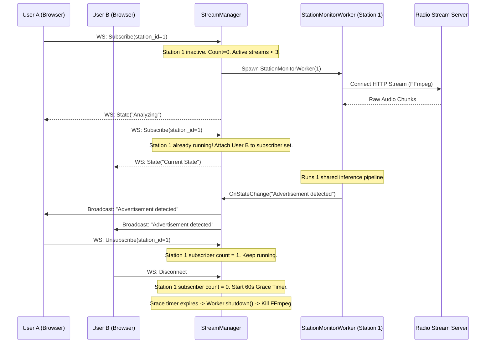

# RadioRadar: Architectural Specification

## 1. Executive Summary & Core Objective

**RadioRadar** is an open-source, resource-conscious platform designed to monitor live internet radio streams and detect commercial advertisements in near real-time.

The system addresses four primary operational requirements:
1. **Multi-station Language Catalog**: Discover and categorize radio stations by language. **Functional ML ad detection is targeted exclusively at English and Hindi**. Conceptual UI placeholder categories include **Tamil, Kannada, and Punjabi** (for frontend catalog browsing without active ML models).
2. **Concurrent Monitoring**: Initial operational target of **1 active stream** for the MVP prototype on Render Free Tier, with a design ceiling of up to 3 streams subject to empirical CPU/RAM benchmarking.
3. **Shared Ingestion Architecture**: Aggregate multiple listeners monitoring the same station into a single backend processing worker, eliminating redundant network bandwidth and CPU/RAM decoding.
4. **Deterministic State Output**: Expose five explicit monitoring states:
   - `Advertisement detected`
   - `No advertisement detected`
   - `Analyzing`
   - `Uncertain`
   - `Unavailable`

---

## 2. System Architecture Overview

RadioRadar is structured into two primary tiers:
- **Client Frontend**: A reactive Single Page Application (SPA) built with React, Vite, and Tailwind CSS.
- **Backend Service**: An asynchronous Python service built with FastAPI, integrating a stream ingestion worker pool, real-time feature extraction, lightweight classification, and WebSocket pub/sub broadcasting.

```mermaid
graph TD
    subgraph "External Streams & Services"
        RB[Radio Browser API (Community Mirror)] -->|Directory Sync / Fallback| DB[(SQLite Rebuildable Cache)]
        StreamSource[Icecast / SHOUTcast / HLS Stream] -->|Audio Stream| IngestWorker[StationMonitorWorker]
    end

    subgraph "RadioRadar Backend (FastAPI / AsyncIO)"
        DB --> CatalogService[Catalog & Language Service]
        CatalogService --> RESTApi[REST Endpoints]
        
        ClientWS[WebSocket Gateway] <-->|Subscribe / Status Stream| StreamManager[StreamManager Singleton]
        
        StreamManager -->|Pool Management (Max 3 Active)| IngestWorker
        
        subgraph "Per-Station Ingestion Pipeline"
            IngestWorker -->|FFmpeg Subprocess / 16kHz PCM| RingBuffer[PCM Ring Buffer 10s]
            RingBuffer -->|Sliding Window 2.5s| FeatureEngine[Acoustic Feature Extractor]
            FeatureEngine -->|MFCC, RMS, ZCR, Spectral| MLInfer[Classifier & Hysteresis Engine]
            MLInfer -->|State: Ads / Music / Talk| StateMachine[Station State Machine]
        end
        
        StateMachine -->|Broadcast State Updates| StreamManager
        StreamManager -->|Pub/Sub Event Bus| ClientWS
    end

    subgraph "Client Frontend (React + Vite + Tailwind)"
        Browser[User Browser]
        ClientWS <-->|WebSocket JSON Frames| WSClient[Frontend WS Client]
        RESTApi -->|Station Search / Languages| StationBrowser[Station Explorer UI]
        WSClient --> StatusCards[3-Slot Monitoring Dashboard]
        Browser -->|Direct Audio Stream (CORS/Native Audio)| StreamSource
    end
```

---

## 3. Component Deep Dive

### 3.1. Station Directory & Rebuildable Storage Cache

#### Upstream Data Source: Radio Browser API
- **API Nature & SLA**: The [Radio Browser API](https://www.radio-browser.info/) is a community-driven, volunteer-operated database indexing over 40,000 global stations. It has **no formal service-level agreement (SLA) or guaranteed uptime**. Network latency varies, and endpoints utilize DNS round-robin across community-hosted mirrors.
- **Resilience, Fallbacks & Validation**:
  - *Strict Request Timeouts*: All outbound API requests to Radio Browser mirrors are configured with a strict 5.0-second timeout.
  - *Retry Limits & Circuit Breaker*: A maximum of 2 retries with exponential backoff. If external mirrors are unreachable, the catalog service trips a circuit breaker and serves solely from the local seed cache.
  - *Static Bundled Seed*: The application bundles a pre-verified static JSON dataset covering functional languages (**English**, **Hindi**) and conceptual placeholder languages (**Tamil**, **Kannada**, **Punjabi**). The service initializes immediately from this seed without waiting for external network calls.
  - *Stream URL Validation*: All stream URLs returned by external sources are validated against an allowlist of supported audio schemes (`http://`, `https://`) and verified to block Server-Side Request Forgery (SSRF) targeting loopback (`127.0.0.1`), link-local (`169.254.169.254`), or private network spaces (`10.0.0.0/8`, `192.168.0.0/16`).

#### Storage Layer: Rebuildable SQLite Cache
- **Storage Classification**: On the free deployment target (Render free tier), the container filesystem is **ephemeral**. Local disk storage is completely destroyed upon instance restart, redeployment, or inactivity spin-down.
- **Operational Reality**: **SQLite is strictly a rebuildable, disposable local cache**, not an authoritative permanent database.
- **Schema**:
  ```sql
  CREATE TABLE stations (
      id TEXT PRIMARY KEY,
      name TEXT NOT NULL,
      stream_url TEXT NOT NULL,
      language TEXT NOT NULL,
      country_code TEXT,
      codec TEXT,
      bitrate INTEGER,
      favicon_url TEXT,
      votes INTEGER DEFAULT 0,
      is_active BOOLEAN DEFAULT TRUE,
      last_checked_at TIMESTAMP
  );

  CREATE INDEX idx_stations_language ON stations(language);
  CREATE INDEX idx_stations_votes ON stations(votes DESC);
  ```
- **Rebuild Lifecycle**: On application startup (including cold boots), the database schema is created in-memory or on local SQLite with WAL mode (`PRAGMA journal_mode=WAL;`), and populated from the bundled seed JSON.
- **Persistent Storage Alternatives**: If user favorites, customized station lists, or historical ad telemetry must be permanently preserved in future milestones, persistent storage must be offloaded to an external managed free-tier database (e.g., Supabase or Neon PostgreSQL) or a persistent cloud disk.

---

### 3.2. Shared Ingestion Architecture (`StreamManager` Singleton)

A critical bottleneck in audio processing is redundant ingestion. If multiple users monitor the same station, opening redundant FFmpeg decoding processes and inference pipelines would quickly exhaust memory and CPU resources.



#### Ingestion Constraints & Lifecycle:
1. **Concurrency Cap**: **1 active station worker as the initial operational target for the MVP prototype** on Render Free Tier (with a design ceiling of up to 3 concurrent streams subject to empirical load and CPU benchmarking in Milestone 2). If capacity is reached:
   - Stations with 0 active subscribers are immediately culled.
   - If all 3 slots have active subscribers, the backend returns a clean status code `SYSTEM_CAPACITY_REACHED` with human-readable messaging.
2. **Subscriber Reference Counting**:
   Each `StationMonitorWorker` maintains a thread-safe `Set[WebSocketID]`. When the set transitions to empty, a 60-second grace timer is initiated. If a subscriber re-joins before expiration (e.g., page refresh), the worker continues running. Otherwise, the audio stream is closed and the FFmpeg subprocess terminated.
3. **Reconnection & Resilience**:
   Internet radio streams drop frequently. Ingestion implements exponential backoff with jitter:
   - Initial retry: 1.0s, doubling up to a maximum 30.0s interval.
   - If audio frames are not received for 10 seconds, the connection is reset.
   - After 3 consecutive reconnection failures, the worker emits the `Unavailable` state.

---

### 3.3. Audio Ingestion & Decoding Pipeline

#### Subprocess FFmpeg vs PyAV Evaluation
- **Subprocess FFmpeg** (`ffmpeg -i <url> -vn -ac 1 -ar 16000 -f f32le -`):
  - *Pros*: Isolated process space. If FFmpeg hangs on a malformed chunk, it can be terminated via `process.kill()` without corrupting Python runtime memory. Built-in demuxers handle SHOUTcast, Icecast, AAC, MP3, and HLS.
  - *Cons*: Subprocess IPC pipe overhead and context-switching cost, which is notable under fractional CPU allocations (0.1 vCPU).
- **PyAV** (FFmpeg C-bindings):
  - *Pros*: In-process frame decoding.
  - *Cons*: Memory leaks in long-running C extensions can crash the Python process on constrained 512MB RAM environments.
- **Decision**: **Subprocess FFmpeg with direct stdout pipe streaming**.
  The worker starts FFmpeg configured to downsample directly to single-channel (mono) 16,000 Hz 32-bit floating point PCM:
  ```bash
  ffmpeg -loglevel quiet -nostats -reconnect 1 -reconnect_at_eof 1 \
         -reconnect_streamed 1 -reconnect_delay_max 5 -timeout 5000000 \
         -i <STREAM_URL> -vn -ac 1 -ar 16000 -f f32le -
  ```
  - Unverified estimated data rate: $16{,}000 \text{ samples/sec} \times 4 \text{ bytes} = 64 \text{ KB/sec}$.
  - A 10-second circular ring buffer requires an estimated $640 \text{ KB}$ of raw PCM RAM per active stream.

---

### 3.4. Feature Extraction & Latency Decomposition

#### Technical Trade-Off: Pure NumPy/SciPy vs. Librosa
The original proposal suggested `librosa`. **Librosa is strictly unsuitable for resource-constrained real-time inference on a 512MB RAM environment:**
1. Librosa is designed for offline music information retrieval. Importing it pulls in heavy dependencies (`numba`, `llvmlite`, `matplotlib`, `scipy`, `soundfile`), adding an unverified estimate of **120MB+** of baseline memory consumption on cold start.
2. Numba JIT compilation causes severe CPU spikes on boot.
3. Feature extraction can be performed with **standard NumPy and SciPy.signal** in fewer than 150 lines of clean, vectorised code with zero Numba overhead.

#### Explicit Decomposition of Detection Latencies
To prevent misleading claims regarding "real-time" performance, the architectural latency is decomposed into four distinct parameters:

| Latency Parameter | Definition | Nominal Duration | Operational Significance |
|---|---|---|---|
| **Audio Analysis Window** | The duration of raw PCM audio required to compute one feature vector. | **2.5 seconds** | Sets the minimum chunk size necessary for representative spectral and MFCC computation. |
| **Prediction Interval** | The cadence at which the sliding window advances and the classifier executes inference. | **0.75 seconds** | Determines CPU computation frequency (hop length: 1.75s overlap between consecutive windows). |
| **State Stabilization Delay** | The duration of sustained probabilistic consensus required by the hysteresis filter to confirm a state change. | **3.0 to 4.5 seconds** | Eliminates rapid UI flickering; requires multiple consecutive agreeing frames before changing state. |
| **Actual Detection Latency** | **Total end-to-end elapsed time** from when an ad begins playing in the radio broadcast until the client UI displays `Advertisement detected`. | **6.0 to 12.0+ seconds** | Sums stream server buffering (1-3s), network transit/jitter (1-2s), window accumulation (2.5s), and stabilization confirmation (3-4.5s). |

#### Feature Vector Structure (32 Dimensions per 2.5s Frame):
1. **RMS Energy & Dynamic Range**: Measures loudness compression (commercials typically show compressed crest factors and elevated sustained RMS).
2. **Zero Crossing Rate (ZCR) & Variance**: Differentiates unvoiced speech/fricatives, voiced speech, and continuous harmonic music.
3. **Spectral Centroid, Rolloff, & Flatness**: Tracks spectral brightness and noise vs. tonal balance.
4. **13 Mel-Frequency Cepstral Coefficients (MFCCs)**: Computed via a static Mel filter bank in NumPy.
5. **Silence & Micro-pause Density**: Identifies boundary silences ($150\text{ms} - 350\text{ms}$) characteristic of radio station commercial insertions.

---

### 3.5. Machine Learning & Decision Engine

#### Reality-Grounded Detection Strategy
Advertisement detection using acoustic features alone without Natural Language Processing (speech-to-text transcription) faces an inherent challenge:
- Spoken ads acoustic profiles closely resemble talk-radio hosts, podcasts, and sports commentary.
- Pop music with vocal intros can resemble jingle-heavy commercials.

Therefore, RadioRadar employs a **Three-Tier Detection Pipeline**:

```mermaid
graph LR
    Frame[2.5s Audio Frame] --> MetadataCheck{Metadata Clue?}
    MetadataCheck -- Yes: Explicit 'Ad' Tag --> EmitAd[State: Ad Detected]
    MetadataCheck -- No Clue --> Extractor[NumPy Acoustic Features]
    
    Extractor --> BaselineModel[Acoustic Classifier]
    BaselineModel --> Prob[P_ad: Ad Probability [0.0 - 1.0]]
    
    Prob --> Hysteresis[Hysteresis & Temporal Smoothing Filter]
    Hysteresis --> FinalState{Confidence Band}
    
    FinalState -- P >= 0.70 for >= 3s --> AdState[Advertisement detected]
    FinalState -- P <= 0.35 for >= 3s --> MusicState[No advertisement detected]
    FinalState -- 0.35 < P < 0.70 --> UncertainState[Uncertain]
    FinalState -- Buffer < 5s --> AnalyzingState[Analyzing]
```

1. **Tier 1: ICY Metadata Heuristic**:
   Some modern stream encoders inject metadata tags (e.g. `Ad: Commercial Break`, `Preroll`, or blank title headers) during dynamic ad insertions (DAI). If present, this immediately flags an ad.
2. **Tier 2: Baseline Machine Learning Classifier**:
   - *Status of Hyperparameters:* Initial configurations (e.g., Random Forest with 50 estimators, max depth 10) are **illustrative starting baselines**, not finalized decisions.
   - *Model Selection Protocol:* The architecture requires empirical comparison against multiple lightweight baselines:
     * Majority-class / Dummy classifier (lower-bound sanity check).
     * Regularized Logistic Regression (minimal CPU/memory footprint).
     * Random Forest vs. Gradient Boosted Trees (LightGBM/HistGradientBoosting).
   - *Dataset Requirements:* A verified, manually labeled radio audio dataset must be collected across targeted languages (English, Hindi, Spanish) before training.
   - *Evaluation Rigor:* Models must be evaluated on a strict **train / validation / test split** (stratified by station and language to prevent data leakage) reporting:
     * Precision, Recall, and F1-score (macro and per-class).
     * Confusion matrices highlighting speech vs. commercial confusion.
     * Per-language evaluation to measure cross-lingual acoustic generalization.
     * Systematic false-positive analysis on talk-radio and news broadcasts.
   - *Zero Fabrication Rule:* No accuracy figures or dataset statistics may be fabricated or claimed without empirical validation.
3. **Tier 3: Temporal Smoothing & Hysteresis State Machine**:
   - A ring buffer holds the last 6 frame probabilities ($4.5\text{ seconds}$).
   - **Hysteresis Logic**:
     * Transition to `Advertisement detected`: Requires weighted probability $> 0.70$ sustained across $\ge 3$ consecutive seconds.
     * Transition to `No advertisement detected`: Requires probability $< 0.35$ sustained across $\ge 3$ consecutive seconds.
     * `Uncertain`: When probability hovers in the ambivalent zone ($0.35 \le P < 0.70$) or during DJ speech over background music.
     * `Analyzing`: Initial state during the first 5 seconds of stream connection while the circular buffer populates.

---

### 3.6. Audio Playback Strategy & Legal / Copyright Realities

#### Architecture: Direct Browser Audio Playback
RadioRadar does not proxy, transcode, or syndicate live audio streams to clients.
- **Backend Role**: Ingests streams strictly into transient, ephemeral in-memory circular buffers ($10\text{ seconds}$ maximum) for mathematical feature calculation. Buffers are overwritten continuously. No audio is recorded to persistent storage or rebroadcast to users.
- **Frontend Role**: When a user selects "Listen", the HTML5 `<audio>` element streams directly from the station's official public `stream_url`.

#### Rigorous Legal & Copyright Analysis
1. **Reduced Redistribution Exposure (Not Absolute Immunity)**:
   - Direct client-to-stream playback substantially **reduces copyright redistribution exposure** because RadioRadar servers never act as a secondary audio broadcaster or re-distributor.
   - **Crucial Clarification**: Direct browser playback does **not** grant automatic, blanket, or complete legal or DMCA immunity.
2. **Broadcaster Terms of Service & Hotlinking**:
   - Individual radio stations and stream content delivery networks (CDNs) may maintain terms of service restricting unauthorized embedding, inline linking ("hotlinking"), or automated monitoring of their stream endpoints.
   - Stream providers may employ geoblocking or session-based referrer checks to prevent external clients from connecting directly.
3. **Transient Processing & Fair Use**:
   - Ephemeral in-memory analysis of broadcast telemetry for metadata extraction (detecting ad segments) aligns with fair-use and transformative research principles in several jurisdictions.
   - However, copyright laws, moral rights, and broadcasting regulations vary internationally.
4. **Requirement for Formal Legal Review**:
   - Prior to any commercial operation, production scaling, or public distribution beyond educational research, RadioRadar requires formal legal review regarding DMCA safe-harbor compliance, local broadcasting rights, and station terms of service.

---

## 4. Communication & WebSocket Protocol

### 4.1. REST Endpoints

| Method | Path | Description |
|---|---|---|
| `GET` | `/api/v1/health` | Service health, memory usage, and active worker count. |
| `GET` | `/api/v1/languages` | List available languages with station counts from cache. |
| `GET` | `/api/v1/stations?language={lang}&search={query}&limit=50` | Search and filter radio stations from rebuildable cache. |
| `GET` | `/api/v1/monitor/status` | Current active monitoring slots and system capacity. |

### 4.2. WebSocket Gateway (`/ws/monitor`)

Clients establish a single WebSocket connection and multiplex up to 3 station subscriptions.

#### Client-to-Server Messages
```json
// Subscribe to station
{
  "action": "subscribe",
  "station_id": "bbc-world-service"
}

// Unsubscribe from station
{
  "action": "unsubscribe",
  "station_id": "bbc-world-service"
}

// Ping / Heartbeat (counts as active inbound traffic)
{
  "action": "ping"
}
```

#### Server-to-Client Messages
```json
// Monitoring State Update
{
  "type": "state_update",
  "station_id": "bbc-world-service",
  "state": "Advertisement detected", // Advertisement detected | No advertisement detected | Analyzing | Uncertain | Unavailable
  "confidence": 0.88,
  "timestamp": 1731513600000,
  "details": {
    "rms_loudness_db": -14.2,
    "speech_confidence": 0.92,
    "current_track": "Sponsor Message"
  }
}

// Capacity / Error Message
{
  "type": "error",
  "code": "CAPACITY_EXCEEDED",
  "message": "Maximum concurrent station capacity (3) reached. Please select an already active station or wait for a slot to free."
}

// Heartbeat Ack
{
  "type": "pong"
}
```

---

## 5. Deployment Architecture & Render Free-Tier Feasibility

### 5.1. Render Free Tier Target Specifications
- **Physical Memory**: 512 MB strict ceiling (Linux kernel OOM killer terminates instance immediately upon exceeding).
- **CPU Allocation**: **0.1 fractional vCPU** (shared, heavily throttled).
- **Inactivity Spin-Down**: Automatically spins down after **15 minutes of inactivity**.
  - *Activity Definition:* Inactivity is determined by inbound HTTP requests or incoming WebSocket messages.
  - *WebSocket Behavior:* **Open WebSocket connections alone should NOT be assumed to prevent spin-down** if the client is merely receiving data and sending zero inbound frames. Clients must actively send ping messages to register activity.
- **Cold-Start Penalty**: When sleeping, container cold boots take approximately **50 to 60+ seconds**.
- **Filesystem**: **Ephemeral local filesystem**. All local disk modifications, including SQLite databases, are completely wiped upon redeploy or sleep cycle.

### 5.2. Practical Operational Impact on Real-Time Monitoring
1. **Stream Worker Termination on Sleep**:
   When the service spins down after 15 minutes of inactivity, all running `StationMonitorWorker` instances and FFmpeg decoding processes are terminated. Active audio ingestion stops completely.
2. **Cold-Start Reconnection Delay**:
   When a user visits the platform after a sleep period, they must wait ~50-60 seconds for container boot, followed by ~5-8 seconds for stream discovery, buffer filling, and initial state stabilization. Total initial time to first state: **~60 to 75 seconds**.
3. **Subprocess & CPU Starvation**:
   Running multiple FFmpeg subprocesses alongside an async Python event loop, decoding pipes, and feature extraction on a **0.1 fractional CPU** introduces severe context-switching overhead. If CPU starvation causes the FFmpeg pipe buffer to fill or drop, audio frames may lag behind real-time broadcast.

### 5.3. Unverified Resource Budget Estimates

> [!WARNING]
> The figures below are **unverified design estimates**. Whether 3 concurrent streams can reliably operate within 512MB RAM and 0.1 CPU without OOM termination or pipe lag **cannot be claimed as verified until empirically benchmarked in Milestone 2 and Milestone 7**.

| Component | Unverified RAM Estimate | Unverified CPU Impact | Resource Mitigation & Bottleneck Notes |
|---|---|---|---|
| **Base Linux OS & Python Runtime** | ~55 MB | Minimal idle | Slim Docker base image (`python:3.11-slim`). |
| **FastAPI + Uvicorn (Single Worker)** | ~40 MB | Low | Asynchronous event loop (`--workers 1`). |
| **NumPy & SciPy (Selective Imports)** | ~70 MB | Low idle, burst on FFT | Direct imports of required modules; excludes full SciPy and Librosa. |
| **Scikit-Learn Classifier** | ~20 MB | Low on 0.75s inference | Constrained baseline model; inference executed at fixed intervals. |
| **FFmpeg Subprocesses (Up to 3)** | ~35 MB each = ~105 MB | **High (Primary 0.1 CPU Bottleneck)** | Process management, pipe context switching; downsampling to 16kHz mono. |
| **PCM Ring Buffers (Up to 3, 10s f32)** | ~2 MB total | Negligible | Circular memory buffer ($640\text{ KB}$ per stream). |
| **SQLite Rebuildable Cache (WAL)** | ~5 MB | Low | In-memory / ephemeral cache for station catalog. |
| **Safety Headroom & Buffer Margin** | ~205 MB | N/A | Buffer against sudden memory spikes or subprocess leaks. |
| **TOTAL ESTIMATE** | **~502 MB** | **Heavily Constrained on 0.1 CPU** | **Requires empirical verification under multi-stream load.** |

---

## 6. Security & Operational Guardrails

1. **SSRF Stream URL Validation**:
   Stream URLs supplied by external directories or users must be strictly validated. They must match allowed protocols (`http://`, `https://`), resolve to public IP ranges, and never point to loopback (`127.0.0.1`), private RFC1918 spaces (`10.0.0.0/8`, `192.168.0.0/16`), or cloud metadata endpoints (`169.254.169.254`).
2. **Subprocess Sandboxing**:
   FFmpeg runs with disabled network reconnect loops on non-HTTP schemas, no shell execution (`shell=False`), and a hard execution timeout on stalled pipe reads.
3. **CORS & Rate Limiting**:
   WebSocket handshake rate limiting prevents denial-of-service attempts that could flood worker allocation.
