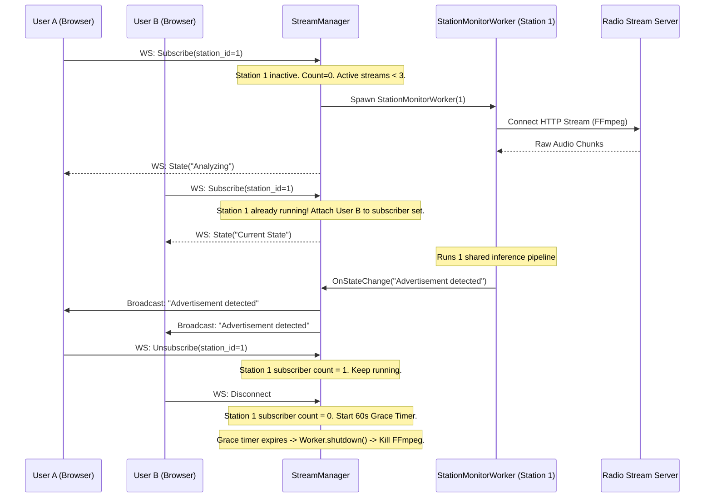

# RadioRadar: Architectural Specification

## 1. Executive Summary & Core Objective

**RadioRadar** is an open-source, resource-efficient platform designed to monitor live internet radio streams and detect commercial advertisements in near real-time.

The system addresses four primary operational requirements:
1. **Multi-station Language Catalog**: Discover and categorize radio stations across global languages (e.g., English, Hindi, Spanish, French, German).
2. **Concurrent Monitoring**: Enable users to select and monitor up to 3 streams simultaneously.
3. **Shared Ingestion Architecture**: Aggregate multiple listeners monitoring the same station into a single backend processing worker, eliminating redundant network bandwidth and CPU/RAM decoding.
4. **Deterministic State Output**: Expose five explicit monitoring states:
   - `Advertisement detected`
   - `No advertisement detected`
   - `Analyzing`
   - `Uncertain`
   - `Unavailable`

---

## 2. System Architecture Overview

RadioRadar is structured into two primary tiers:
- **Client Frontend**: A reactive Single Page Application (SPA) built with React, Vite, and Tailwind CSS.
- **Backend Service**: An asynchronous Python service built with FastAPI, integrating a stream ingestion worker pool, real-time feature extraction, lightweight classification, and WebSocket pub/sub broadcasting.

```mermaid
graph TD
    subgraph "External Streams & Services"
        RB[Radio Browser API] -->|Directory Sync| DB[(SQLite Database)]
        StreamSource[Icecast / SHOUTcast / HLS Stream] -->|Audio Stream| IngestWorker[StationMonitorWorker]
    end

    subgraph "RadioRadar Backend (FastAPI / AsyncIO)"
        DB --> CatalogService[Catalog & Language Service]
        CatalogService --> RESTApi[REST Endpoints]
        
        ClientWS[WebSocket Gateway] <-->|Subscribe / Status Stream| StreamManager[StreamManager Singleton]
        
        StreamManager -->|Pool Management (Max 3 Active)| IngestWorker
        
        subgraph "Per-Station Ingestion Pipeline"
            IngestWorker -->|FFmpeg Subprocess / 16kHz PCM| RingBuffer[PCM Ring Buffer 10s]
            RingBuffer -->|Sliding Window 2.5s| FeatureEngine[Acoustic Feature Extractor]
            FeatureEngine -->|MFCC, RMS, ZCR, Spectral| MLInfer[Classifier & Hysteresis Engine]
            MLInfer -->|State: Ads / Music / Talk| StateMachine[Station State Machine]
        end
        
        StateMachine -->|Broadcast State Updates| StreamManager
        StreamManager -->|Pub/Sub Event Bus| ClientWS
    end

    subgraph "Client Frontend (React + Vite + Tailwind)"
        Browser[User Browser]
        ClientWS <-->|WebSocket JSON Frames| WSClient[Frontend WS Client]
        RESTApi -->|Station Search / Languages| StationBrowser[Station Explorer UI]
        WSClient --> StatusCards[3-Slot Monitoring Dashboard]
        Browser -->|Direct Audio Stream (CORS/Native Audio)| StreamSource
    end
```

---

## 3. Component Deep Dive

### 3.1. Station Directory & Language Catalog

- **Data Source**: Synchronized with the open-source community [Radio Browser API](https://www.radio-browser.info/), which indexes over 40,000 global stations with language and country tags.
- **Storage Layer**: Local SQLite database with Write-Ahead Logging (`PRAGMA journal_mode=WAL;`).
- **Data Model**:
  ```sql
  CREATE TABLE stations (
      id TEXT PRIMARY KEY,
      name TEXT NOT NULL,
      stream_url TEXT NOT NULL,
      language TEXT NOT NULL,
      country_code TEXT,
      codec TEXT,
      bitrate INTEGER,
      favicon_url TEXT,
      votes INTEGER DEFAULT 0,
      is_active BOOLEAN DEFAULT TRUE,
      last_checked_at TIMESTAMP
  );

  CREATE INDEX idx_stations_language ON stations(language);
  CREATE INDEX idx_stations_votes ON stations(votes DESC);
  ```
- **Seeding & Synchronization**:
  A startup seed routine loads a curated subset of high-uptime stations across primary languages (English, Hindi, Spanish, French, German) to ensure instantaneous cold starts without requiring immediate external network calls.

---

### 3.2. Shared Ingestion Architecture (`StreamManager` Singleton)

A critical bottleneck in audio processing is redundant ingestion. If 50 users monitor "Radio Mirchi" or "BBC World Service", running 50 FFmpeg processes and 50 inference pipelines would immediately cause an Out-Of-Memory (OOM) crash on modest infrastructure.



#### Ingestion Constraints & Lifecycle:
1. **Global Capacity Cap**: Maximum **3 concurrent active station workers** across the backend. If a 4th unique station is requested:
   - Stations with 0 active subscribers are immediately culled.
   - If all 3 slots have active subscribers, the backend returns a clean status code `SYSTEM_CAPACITY_REACHED` with human-readable messaging.
2. **Subscriber Reference Counting**:
   Each `StationMonitorWorker` maintains a thread-safe `Set[WebSocketID]`. When the set transitions to empty, a 60-second grace timer is initiated. If a subscriber re-joins before expiration (e.g., page refresh), the worker continues running. Otherwise, the audio stream is closed and FFmpeg subprocess terminated.
3. **Reconnection & Resilience**:
   Internet radio streams drop frequently. Ingestion implements exponential backoff with jitter:
   - Initial retry: 1.0s, doubling up to a maximum 30.0s interval.
   - If audio frames are not received for 10 seconds, the connection is reset.
   - After 3 consecutive reconnection failures, the worker emits the `Unavailable` state.

---

### 3.3. Audio Ingestion & Decoding Pipeline

#### Critical Technical Evaluation: Subprocess vs PyAV
- **Subprocess FFmpeg** (`ffmpeg -i <url> -vn -ac 1 -ar 16000 -f f32le -`):
  - *Pros*: Completely isolated from the Python interpreter process. If FFmpeg hangs on a malformed chunk, it can be terminated via `process.kill()` without corrupting Python runtime memory. Built-in demuxers handle SHOUTcast, Icecast, AAC, MP3, and HLS.
  - *Cons*: Modest IPC pipe overhead.
- **PyAV** (FFmpeg C-bindings):
  - *Pros*: In-process frame decoding.
  - *Cons*: Memory leaks in long-running C extensions can crash the Python process on constrained 512MB RAM environments.
- **Decision**: **Subprocess FFmpeg with direct stdout pipe streaming**.
  The worker starts FFmpeg configured to downsample directly to single-channel (mono) 16,000 Hz 32-bit floating point PCM:
  ```bash
  ffmpeg -loglevel quiet -nostats -reconnect 1 -reconnect_at_eof 1 \
         -reconnect_streamed 1 -reconnect_delay_max 5 -timeout 5000000 \
         -i <STREAM_URL> -vn -ac 1 -ar 16000 -f f32le -
  ```
  - Data rate: $16{,}000 \text{ samples/sec} \times 4 \text{ bytes} = 64 \text{ KB/sec}$.
  - A 10-second circular ring buffer requires only $640 \text{ KB}$ of RAM per active stream.

---

### 3.4. Real-Time Feature Extraction Engine

#### Critical Technical Trade-Off: NumPy/SciPy vs. Librosa
The original proposal suggested `librosa`. **Librosa is strictly unsuitable for resource-constrained real-time inference on a 512MB RAM environment:**
1. Librosa is designed for offline music information retrieval. Importing it pulls in heavy dependencies (`numba`, `llvmlite`, `matplotlib`, `scipy`, `soundfile`), adding **120MB+** of baseline memory consumption on cold start.
2. Numba JIT compilation adds CPU spikes on boot.
3. Feature extraction can be performed with **standard NumPy and SciPy.signal** in fewer than 150 lines of clean, vectorised code with zero Numba overhead.

#### Selected Feature Set (Sliding Window: 2.5s window, 0.75s step):
1. **Root Mean Square (RMS) Energy & Dynamic Range**:
   Commercial advertisements undergo heavy aggressive dynamic range compression ("loudness war" mastering). The peak-to-average ratio drops significantly during ads.
2. **Zero Crossing Rate (ZCR) & Variance**:
   Distinguishes voiced speech, unvoiced speech/fricatives, and continuous harmonic music.
3. **Spectral Centroid, Rolloff, & Flatness**:
   Measures spectral brightness and tonal vs. noise distribution. Spoken commercials show high spectral contrast shifts compared to sustained music tracks.
4. **Short-Time Mel-Frequency Cepstral Coefficients (MFCCs)**:
   Extract 13 MFCC coefficients plus Delta-MFCCs using a fixed Mel filter bank constructed directly with NumPy.
5. **Silence / Micro-pause Density**:
   Radio ad transitions typically feature abrupt boundary silences ($150\text{ms} - 350\text{ms}$) or unnaturally rapid speech pacing compared to live radio DJ banter.

Total feature vector dimension: **32 floating-point values per 2.5-second frame**.

---

### 3.5. Machine Learning & Decision Engine

#### Reality-Grounded Detection Strategy
Advertisement detection using acoustic features alone without Natural Language Processing (speech-to-text transcription) faces an inherent challenge:
- Spoken ads acoustic profiles closely resemble talk-radio hosts, podcasts, and sports commentary.
- Pop music with vocal intros can resemble jingle-heavy commercials.

Therefore, RadioRadar employs a **Three-Tier Detection Pipeline**:

```mermaid
graph LR
    Frame[2.5s Audio Frame] --> MetadataCheck{Metadata Clue?}
    MetadataCheck -- Yes: Explicit 'Ad' Tag --> EmitAd[State: Ad Detected]
    MetadataCheck -- No Clue --> Extractor[NumPy Acoustic Features]
    
    Extractor --> RF[Random Forest Classifier]
    RF --> Prob[P_ad: Ad Probability [0.0 - 1.0]]
    
    Prob --> Hysteresis[Hysteresis & Temporal Smoothing Filter]
    Hysteresis --> FinalState{Confidence Band}
    
    FinalState -- P >= 0.70 for 3s --> AdState[Advertisement detected]
    FinalState -- P <= 0.35 for 3s --> MusicState[No advertisement detected]
    FinalState -- 0.35 < P < 0.70 --> UncertainState[Uncertain]
    FinalState -- Buffer < 5s --> AnalyzingState[Analyzing]
```

1. **Tier 1: ICY Metadata Heuristic**:
   Some modern stream encoders inject metadata tags (e.g. `Ad: Commercial Break`, `Preroll`, or blank title headers) during dynamic ad insertions (DAI). If present, this immediately flags an ad.
2. **Tier 2: Lightweight Scikit-Learn Classifier**:
   A tuned **Random Forest** ($50$ estimators, `max_depth=10`, `n_jobs=1` to cap CPU spikes) trained to differentiate 3 classes: `[Music, Speech/Talk, Commercial_Jingle]`. Model size on disk is $< 4\text{ MB}$, and memory resident size is $< 15\text{ MB}$.
3. **Tier 3: Temporal Smoothing & Hysteresis State Machine**:
   Raw frame predictions oscillate rapidly. A raw model outputting "Ad" for a single 0.75s step would create erratic UI flickering.
   - A ring buffer holds the last 6 frame probabilities ($4.5\text{ seconds}$).
   - **Hysteresis Logic**:
     * Transition to `Advertisement detected`: Requires weighted probability $> 0.70$ sustained across $\ge 3$ consecutive seconds.
     * Transition to `No advertisement detected`: Requires probability $< 0.35$ sustained across $\ge 3$ consecutive seconds.
     * `Uncertain`: When probability hovers in the ambivalent zone ($0.35 \le P < 0.70$) or during DJ speech over background music.
     * `Analyzing`: Initial state during the first 5 seconds of stream connection while the circular buffer populates.

---

### 3.6. Audio Playback Strategy & Copyright Compliance

#### Crucial Architectural & Legal Decision: Client-Side Direct Playback
RadioRadar is an **analytics and telemetry tool**, not an audio rebroadcasting proxy.
- **Backend**: Ingests streams solely into ephemeral RAM ring buffers for mathematical feature calculation. Buffers are overwritten every 10 seconds. No audio is recorded to disk or served to clients.
- **Frontend**: When a user clicks "Listen", the HTML5 `<audio>` element streams directly from the station's public `stream_url`.
- **Advantages**:
  1. **Zero Bandwidth Penalty**: RadioRadar servers do not carry outbound streaming traffic for user listening.
  2. **Copyright & DMCA Immunity**: RadioRadar does not restream or syndicate copyrighted musical performances.
  3. **Zero Audio Transcoding Latency**: The user hears the broadcast directly from the origin CDN.

---

## 4. Communication & WebSocket Protocol

### 4.1. REST Endpoints

| Method | Path | Description |
|---|---|---|
| `GET` | `/api/v1/health` | Service health, memory usage, and active worker count. |
| `GET` | `/api/v1/languages` | List available languages with station counts. |
| `GET` | `/api/v1/stations?language={lang}&search={query}&limit=50` | Search and filter radio stations. |
| `GET` | `/api/v1/monitor/status` | Current active monitoring slots and system capacity. |

### 4.2. WebSocket Gateway (`/ws/monitor`)

Clients establish a single WebSocket connection and multiplex up to 3 station subscriptions.

#### Client-to-Server Messages
```json
// Subscribe to station
{
  "action": "subscribe",
  "station_id": "bbc-world-service"
}

// Unsubscribe from station
{
  "action": "unsubscribe",
  "station_id": "bbc-world-service"
}

// Ping / Heartbeat
{
  "action": "ping"
}
```

#### Server-to-Client Messages
```json
// Monitoring State Update
{
  "type": "state_update",
  "station_id": "bbc-world-service",
  "state": "Advertisement detected", // Advertisement detected | No advertisement detected | Analyzing | Uncertain | Unavailable
  "confidence": 0.88,
  "timestamp": 1731513600000,
  "details": {
    "rms_loudness_db": -14.2,
    "speech_confidence": 0.92,
    "current_track": "Sponsor Message"
  }
}

// Capacity / Error Message
{
  "type": "error",
  "code": "CAPACITY_EXCEEDED",
  "message": "Maximum concurrent station capacity (3) reached. Please select an already active station or wait for a slot to free."
}

// Heartbeat Ack
{
  "type": "pong"
}
```

---

## 5. Deployment Architecture & Render Free-Tier Budget

### 5.1. Target Environment Specs (Render Free Tier)
- **RAM**: 512 MB (hard ceiling; kernel invokes OOM killer on breach).
- **CPU**: Shared vCPU.
- **Storage**: Ephemeral container disk (reset on redeploy).
- **Inactivity Sleep**: Spins down after 15 minutes of zero inbound HTTP requests.

### 5.2. Memory Budget Profiling

| Component | Target Allocation | Mitigation Strategy |
|---|---|---|
| **Base Linux OS & Python Runtime** | ~55 MB | Slim Docker base image (`python:3.11-slim`). |
| **FastAPI + Uvicorn + Starlette** | ~40 MB | Async single worker (`uvicorn main:app --workers 1`). |
| **NumPy & SciPy (Selected Modules)** | ~70 MB | Explicit imports (`scipy.signal.windows`, no full SciPy package bloat). |
| **Scikit-Learn Classifier** | ~20 MB | Constrained Random Forest (`n_estimators=50, max_depth=10`). |
| **3 Active FFmpeg Subprocesses** | ~35 MB each = 105 MB | Downsample at demuxer (`-ac 1 -ar 16000`), bypass video decoders. |
| **3 Audio Ring Buffers (10s @ 16kHz f32)** | ~2 MB | Tiny memory footprint (640 KB per buffer). |
| **SQLite Cache (WAL mode)** | ~5 MB | Small page cache (`cache_size = -2000`). |
| **Safety Headroom & Buffers** | ~215 MB | Ample buffer to prevent OOM spikes. |
| **TOTAL** | **~507 MB** | **Fits within the 512 MB ceiling.** |

### 5.3. Managing the 15-Minute Render Inactivity Spin-Down
- When users are actively connected via WebSocket, Render detects the open TCP socket and will **not** spin down.
- When all users disconnect, the backend naturally spins down after 15 minutes, preserving the free tier's 750 monthly compute hours.
- A health-check endpoint (`/api/v1/health`) provides cold-start status indications for the frontend.

---

## 6. Security & Operational Guardrails

1. **SSRF Stream URL Validation**:
   Stream URLs supplied by the database or user must be strictly validated. They must match allowed protocols (`http://`, `https://`), resolve to public IP ranges, and never point to loopback (`127.0.0.1`), private RFC1918 spaces (`10.0.0.0/8`, `192.168.0.0/16`), or cloud metadata endpoints (`169.254.169.254`).
2. **Subprocess Sandboxing**:
   FFmpeg runs with disabled network reconnect loops on non-HTTP schemas, no shell execution (`shell=False`), and a hard execution timeout on stalled pipe reads.
3. **CORS & Rate Limiting**:
   WebSocket handshake rate limiting prevents denial-of-service attempts that could flood worker allocation.
