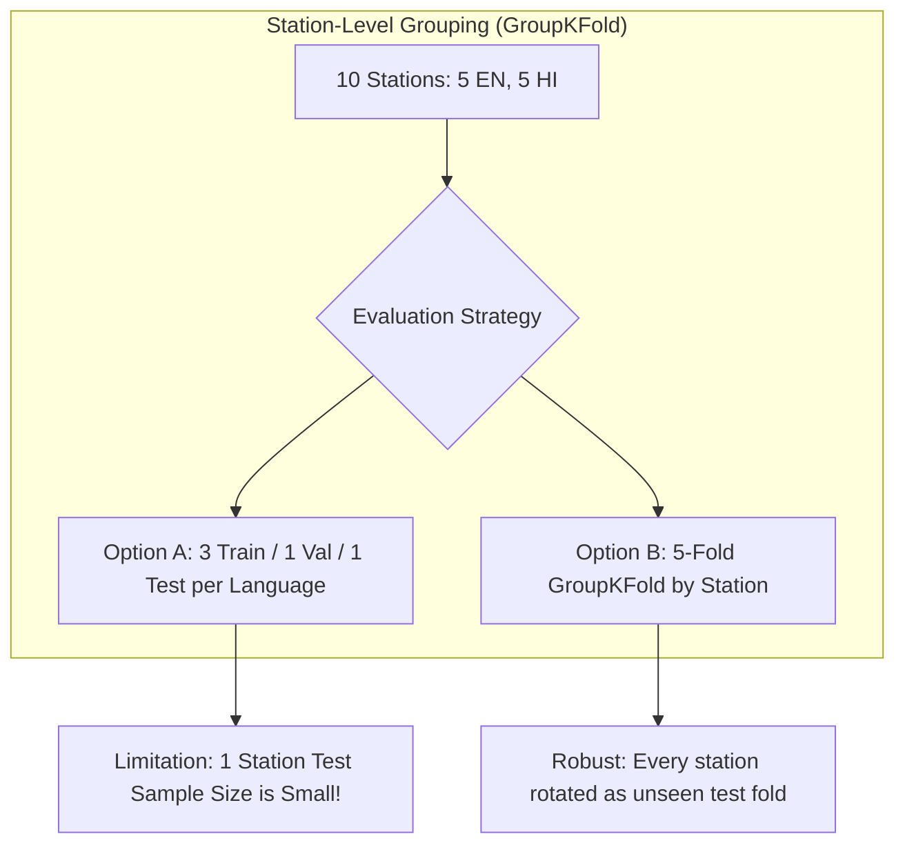

# RadioRadar: Comprehensive Dataset Research & Data Strategy

**Project:** RadioRadar  
**Milestone:** 0.3 - Dataset Research and Machine Learning Feasibility  
**Role:** Senior Machine Learning Research Engineer & Audio-Processing Specialist  
**Status:** Completed Research Integrity Audit & Dataset Correction  

---

## 1. Executive Summary & Research Objectives

The objective of this research is to evaluate public audio, speech, music, and broadcast datasets to determine whether existing data can train or benchmark RadioRadar's radio advertisement detection engine, specifically for its two **functional target languages**: **English** and **Hindi**.

### Fundamental Research Findings:
1. **Zero Off-the-Shelf Labeled Radio Commercial Datasets**: There is **no publicly accessible, standardized audio dataset of labeled live radio advertisements** for either English or Hindi `[VERIFIED FACT]`. Commercial media monitoring platforms rely on closed, proprietary fingerprinting databases.
2. **Tabular Video Features vs. Raw Radio Streams**: The only notable public broadcast commercial dataset is the *UCI TV News Channel Commercial Detection Dataset* (IIIT Hyderabad, 2015) `[VERIFIED FACT]`. However, it provides only pre-extracted tabular features from television video shots (not raw streaming audio waveforms), making it unsuitable for training raw audio feature extractors.
3. **Speech and Music Datasets Do Not Solve Commercial Detection**: While high-quality speech and music datasets exist (e.g., MUSAN, GTZAN, Kathbath, Shrutilipi) `[VERIFIED FACT]`, classifying speech vs. music does not equate to detecting advertisements. Commercials encompass spoken dialogue, musical jingles, hybrid voiceovers over music beds, sound effects, and rapid disclaimers.
4. **Mandatory Custom Data Collection**: A working prototype for RadioRadar **requires** a manually curated, station-stratified audio benchmark dataset recorded directly from public radio broadcasts.
5. **Language Boundary Definition**:
   - **Functional Languages**: **English** and **Hindi** are the sole targets for ML training, feature extraction, and functional advertisement detection.
   - **Conceptual / Dummy Languages**: **Tamil**, **Kannada**, and **Punjabi** are conceptual UI placeholders to validate language-grouping catalog features in the frontend. They have zero ML models, zero training data, and zero detection capabilities in this release. Never represent these three conceptual languages as working detection capabilities.

---

## 2. Comprehensive Dataset Survey

We investigated public datasets across six functional categories:
- **Category A:** Commercial Advertisement Datasets
- **Category B:** Radio Broadcast Datasets
- **Category C:** Speech and Music Classification Datasets
- **Category D:** General Audio Event Classification Datasets
- **Category E:** Multilingual Speech Datasets (English, Hindi, and Indian Languages)
- **Category F:** Promotional & Advertising Speech Corpora

---

### Category A: Commercial Advertisement Datasets

#### 1. TV News Channel Commercial Detection Dataset
- **Publisher / Institution:** International Institute of Information Technology (IIIT) Hyderabad, India (Prithviraj Sen, C. V. Jawahar et al.).
- **Official Website / URL:** `https://archive.ics.uci.edu/dataset/326/tv+news+channel+commercial+detection+dataset`
- **Source Confidence:** HIGH `[VERIFIED FACT]`.
- **Dataset Size / Duration:** ~150 hours total across 5 TV news channels (3 Indian: CNN-IBN, NDTV 24x7, Times Now; 2 International: BBC, CNN; ~30 hours per channel) `[VERIFIED FACT]`.
- **Instances:** ~129,685 instances corresponding to individual video shots `[VERIFIED FACT]`.
- **Languages:** English and Indian English (with incidental code-switched Hindi-English broadcast segments).
- **Audio Format:** **No raw audio files provided.** Tabular ASCII text format containing 12 pre-extracted shot features (7 audio: Short-Term Energy, Zero-Crossing Rate, Spectral Centroid, Spectral Flux, Spectral Rolloff, Fundamental Frequency, MFCC Bag-of-Audio-Words; 5 visual: shot length, motion, text distribution, edge change ratio) `[VERIFIED FACT]`.
- **Available Annotations:** Binary class labels: `+1` (Commercial) vs. `-1` (Non-commercial / News content) `[VERIFIED FACT]`.
- **Explicit Ad Labels & Timestamps:** Commercials are labeled per video shot, but exact wall-clock audio timestamps are coupled to TV video shots, not continuous radio audio streams.
- **Distinguishability:** Separates commercial blocks from news anchor dialogue in television broadcasts.
- **License / Permissions:** Open for academic research via UCI Machine Learning Repository; non-commercial research use.
- **Registration / Approval:** Free direct download via UCI / Kaggle mirrors; no registration required.
- **Practical Usability:** **Useful only for experimentation with tabular models.** Because raw audio waveforms are omitted, RadioRadar cannot use this dataset to validate its FFmpeg raw PCM decoding, sliding-window chunking, or custom NumPy feature extractors.
- **Classification:** **Useful only for experimentation.**

---

### Category B: Radio Broadcast Datasets

#### 2. RadioTalk Corpus
- **Publisher / Institution:** Massachusetts Institute of Technology (MIT) Media Lab (Lab for Social Machines; Will Brannon, Deb Roy et al.).
- **Official Website / URL:** `https://github.com/social-machines/RadioTalk` / Hosted on AWS S3 (`s3://radio-talk/v1.0/`).
- **Source Confidence:** HIGH `[VERIFIED FACT]`.
- **Dataset Nature & Scope:** RadioTalk is **primarily a talk-radio transcript corpus** `[VERIFIED FACT]`. It contains roughly 2.8 billion words of automatic speech recognition (ASR) transcripts generated from ~284,000 hours of US talk-radio broadcasts (October 2018 – March 2019) `[RESEARCH-REPORTED RESULT]`.
- **Audio Availability Reality**: **RadioTalk must not be represented as a collection of downloadable 16 kHz WAV training snippets.** The public distribution hosted on S3 consists of compressed JSONL metadata files (`radiotalk.json.gz`, ~9.3 GB) containing ASR transcripts, speaker IDs, timestamps, show names, call signs, and pre-trained word embeddings `[VERIFIED FACT]`. Raw broadcast audio files (`.wav` or `.mp3`) are **not** distributed in the public release due to file storage scale and broadcast copyright restrictions `[VERIFIED FACT]`.
- **Languages:** US English.
- **Explicit Ad Labels:** **NO.** Commercials are not labeled or segmented; commercial breaks are either transcribed as generic speech or omitted by the automated capture pipeline `[VERIFIED FACT]`.
- **License / Permissions:** Custom MIT research release. Free for academic non-commercial research.
- **Actual Usefulness & Limitations for RadioRadar**:
  - *Actual Usefulness*: Useful for NLP researchers studying conversational text patterns and language modeling of talk radio.
  - *Critical Limitations*: Because raw audio waveforms are not distributed, RadioRadar **cannot** use RadioTalk to train or evaluate acoustic feature models (MFCCs, spectral flux, zero-crossing rate) or sliding-window audio decoders.
- **Classification:** **Not sufficiently relevant for acoustic training.**

#### 3. Shrutilipi (All India Radio News Corpus)
- **Publisher / Institution:** AI4Bharat (IIT Madras), India.
- **Official Website / URL:** `https://github.com/AI4Bharat/Shrutilipi` / `https://huggingface.co/datasets/ai4bharat/Shrutilipi`
- **Source Confidence:** HIGH `[VERIFIED FACT]`.
- **Dataset Size / Duration:** ~6,400+ hours of multi-lingual broadcast news audio mined from Prasar Bharati's **All India Radio (AIR)** bulletins `[RESEARCH-REPORTED RESULT]`.
- **Audio Format:** 16 kHz mono WAV / MP3 `[VERIFIED FACT]`.
- **Languages:** 12+ Indian languages including Hindi (1,000+ hours), Tamil, Kannada, Punjabi, etc. `[VERIFIED FACT]`.
- **Available Annotations:** Text transcripts aligned at the sentence level from official AIR news bulletins.
- **Explicit Ad Labels:** **NO.** All India Radio news bulletins are public service broadcasts and contain virtually no commercial advertisements `[VERIFIED FACT]`.
- **License / Permissions:** Creative Commons Attribution 4.0 International (CC BY 4.0).
- **Registration / Approval:** Fully public download on Hugging Face.
- **Practical Usability:** **Valuable auxiliary negative benchmark for Hindi.** It provides real-world broadcast-quality Hindi speech recorded from radio transmissions, serving as a challenging test set to evaluate false-positive rates on formal Hindi news reading.
- **Classification:** **Useful for auxiliary model development.**

---

### Category C: Speech and Music Classification Datasets

#### 4. MUSAN: A Music, Speech, and Noise Corpus (OpenSLR 17)
- **Publisher / Institution:** Center for Language and Speech Processing, Johns Hopkins University (David Snyder, Guoguo Chen, Daniel Povey).
- **Official Website / URL:** `https://www.openslr.org/17/`
- **Source Confidence:** HIGH `[VERIFIED FACT]`.
- **Dataset Size / Duration:** ~109 hours total (~11 GB uncompressed) `[VERIFIED FACT]`:
  - Speech: ~60 hours (LibriVox audiobooks, US parliamentary hearings).
  - Music: ~42 hours (various genres: classical, jazz, rock, pop).
  - Noise: ~7 hours (technical, ambient, atmospheric).
- **Number of Audio Files:** ~6,000+ files.
- **Audio Format:** 16 kHz mono 16-bit WAV files (matches RadioRadar's PCM pipeline) `[VERIFIED FACT]`.
- **Languages:** English predominates in speech; multi-lingual samples included.
- **Available Annotations:** Categorical folder hierarchy (`speech/`, `music/`, `noise/`) with subgenre/speaker metadata.
- **Explicit Ad Labels:** **NO.** Contains zero commercial advertisements `[VERIFIED FACT]`.
- **License / Permissions:** Creative Commons Attribution 4.0 International (CC BY 4.0). Subsets map to public domain / CC-BY.
- **Practical Usability:** **Essential baseline auxiliary dataset.** Allows rigorous local validation of the pure NumPy/SciPy acoustic feature extractor (MFCCs, spectral centroid, ZCR, RMS) to ensure that RadioRadar's pipeline accurately separates pure music from spoken dialogue.
- **Classification:** **Useful for auxiliary model development.**

#### 5. GTZAN Music/Speech Collection
- **Publisher / Institution:** George Tzanetakis (Princeton University / Marsyas Framework).
- **Official Website / URL:** `http://marsyas.info/downloads/datasets.html` / Mirror via TensorFlow Datasets `gtzan_music_speech`.
- **Source Confidence:** HIGH `[VERIFIED FACT]`.
- **Dataset Size / Duration:** 120 audio tracks (60 speech, 60 music), each exactly 30 seconds long (total 60 minutes) `[VERIFIED FACT]`.
- **Audio Format:** 22,050 Hz 16-bit mono WAV.
- **Languages:** English speech.
- **Available Annotations:** Binary class: `music` vs. `speech`.
- **Explicit Ad Labels:** **NO.**
- **License / Permissions:** Open for educational and academic research.
- **Practical Usability:** Small, lightweight test set for sanity checks during unit testing of feature extraction algorithms.
- **Classification:** **Useful only for experimentation.**

---

### Category D: General Audio Event Classification Datasets

#### 6. Google AudioSet
- **Publisher / Institution:** Google Research (Jort F. Gemmeke et al.).
- **Official Website / URL:** `https://research.google.com/audioset/`
- **Source Confidence:** HIGH `[VERIFIED FACT]`.
- **Dataset Scope & Format:** 2.1 million 10-second audio clips extracted from YouTube videos (~5,800 hours), mapped across an ontology of 632 sound event classes `[VERIFIED FACT]`.
- **Jingle (music) Category (`/m/02gzf6`) Analysis**:
  - *Official Definition*: *"A short song or tune used in advertising and for other commercial uses. The jingle contains one or more hooks that explicitly promote the product or service being advertised."* `[VERIFIED FACT]`
  - *Verified Clip Counts*:
    * **Total Clips**: 1,438 clips (~4.0 hours) `[VERIFIED FACT]`.
    * **Balanced Train Set**: 60 clips (~0.2 hours) `[VERIFIED FACT]`.
    * **Unbalanced Train Set**: 1,318 clips (~3.6 hours) `[VERIFIED FACT]`.
    * **Evaluation Set**: 60 clips (~0.2 hours) `[VERIFIED FACT]`.
- **Critical Limitations & Misconceptions**:
  1. *YouTube-Origin Limitation*: AudioSet does not host raw audio files; it provides CSVs of YouTube video IDs and segment timestamps. Researchers must scrape clips using `yt-dlp`. Because YouTube videos are routinely deleted, set to private, or region-blocked, scraping yields an incomplete subset. Furthermore, YouTube audio encoding and video soundtracks differ markedly from FM broadcast processing.
  2. *Jingles vs. Advertisements*: **Detecting jingles is NOT equivalent to detecting advertisements.** Radio commercials frequently feature spoken dialogue, customer testimonials, local business announcements, dramatic skits, speed-talk disclaimers, and conversational banter without any musical jingle. A model trained exclusively on jingles will exhibit severe false-negative rates on non-musical advertisements.
  3. *No Dedicated "Commercial" Class*: AudioSet does **not** contain classes for "Television advertisement", "Radio commercial", or "Sponsor read" `[VERIFIED FACT]`.
- **Conclusion**: AudioSet must **not** be represented as a comprehensive commercial advertising dataset. It provides auxiliary positive examples of musical jingles only.
- **Classification:** **Useful for auxiliary model development.**

---

### Category E: Multilingual Speech Datasets (English & Hindi)

#### 7. Kathbath (AI4Bharat)
- **Publisher / Institution:** AI4Bharat (IIT Madras), India.
- **Official Website / URL:** `https://github.com/AI4Bharat/indic-superb` / Hugging Face `ai4bharat/kathbath`
- **Source Confidence:** HIGH `[VERIFIED FACT]`.
- **Dataset Size / Duration:** ~1,684 hours of human-labeled read speech across 12 Indian languages (~150 hours for Hindi) `[RESEARCH-REPORTED RESULT]`.
- **Audio Format:** 16 kHz mono WAV `[VERIFIED FACT]`.
- **Languages:** Hindi, Tamil, Kannada, Punjabi, Bengali, Gujarati, Malayalam, Marathi, Odia, Sanskrit, Telugu, Urdu.
- **Explicit Ad Labels:** **NO.** Crowdsourced read speech only `[VERIFIED FACT]`.
- **License / Permissions:** Creative Commons Attribution-ShareAlike 4.0 (CC BY-SA 4.0).
- **Practical Usability:** High-quality clean Hindi speech baseline to verify speech acoustic properties and test negative speech samples.
- **Classification:** **Useful for auxiliary model development.**

#### 8. Mozilla Common Voice (English & Hindi)
- **Publisher / Institution:** Mozilla Foundation.
- **Official Website / URL:** `https://commonvoice.mozilla.org/`
- **Source Confidence:** HIGH `[VERIFIED FACT]`.
- **Dataset Size / Duration:** English (v15.0+): 3,000+ hours; Hindi: ~30 hours of verified speech `[RESEARCH-REPORTED RESULT]`.
- **Audio Format:** 48 kHz / 16 kHz MP3/WAV.
- **Explicit Ad Labels:** **NO.** Sentence-level read speech only `[VERIFIED FACT]`.
- **License / Permissions:** Creative Commons Zero (CC0 - Public Domain Dedication).
- **Classification:** **Useful only for experimentation.**

#### 9. MUCS / OpenSLR 104 (Hindi-English Code-Switching ASR Corpus)
- **Publisher / Institution:** Multilingual and Code-Switching ASR Challenge (IIT Dharwad, IIT Madras, Microsoft).
- **Official Website / URL:** `https://www.openslr.org/104/`
- **Source Confidence:** HIGH `[VERIFIED FACT]`.
- **Dataset Size / Duration:** ~90 hours training, ~5 hours evaluation of Hindi-English code-switched speech extracted from technical lectures `[VERIFIED FACT]`.
- **Audio Format:** 16 kHz mono 16-bit WAV `[VERIFIED FACT]`.
- **Languages:** Hindi-English code-switched (Hinglish).
- **Explicit Ad Labels:** **NO.**
- **License / Permissions:** Creative Commons Attribution 4.0 (CC BY 4.0).
- **Practical Usability:** Useful for studying acoustic properties of bilingual Indian speakers. Does not provide ad labels.
- **Classification:** **Useful for auxiliary model development.**

---

### Category F: Unverified Community Projects

#### 10. rvdmaazen/Radio-Audio-Classification
- **Source / Repository:** GitHub repository `rvdmaazen/Radio-Audio-Classification`.
- **Source Confidence:** **UNVERIFIED AS A PUBLIC DATASET** `[VERIFIED FACT]`.
- **Audit Findings**:
  - The repository contains shell scripts (`record_streams.sh`) and Python scripts (`create_snippets.py`) written by an individual developer to scrape Dutch radio streams via FFmpeg and slice them locally into 1-second snippets `[VERIFIED FACT]`.
  - **No downloadable dataset files, raw audio files, or verified annotation files are hosted or published** in the repository or any external academic repository `[VERIFIED FACT]`.
  - The audio files remain private to the author's local machine due to broadcast copyright limitations.
- **Correction Action**: **Marked strictly as UNVERIFIED. Removed from confirmed dataset recommendations.** RadioRadar will not cite or rely on private unverified community scrapers as benchmark datasets.
- **Classification:** **Not sufficiently relevant / Unverified.**

---

## 3. Systematic Dataset Evaluation Matrix

| Dataset Name | Publisher | Size / Duration | Audio Provided? | Explicit Ad Labels? | License | Downloadable? | Status / Classification | Source Confidence |
|---|---|---|---|---|---|---|---|---|
| **1. UCI Commercial** | IIIT Hyderabad | 150h (~130k shots) | **NO (Tabular features only)** | **YES (+1 / -1)** | Open Academic | Yes | **Experimentation only** | **HIGH** `[VERIFIED FACT]` |
| **2. RadioTalk** | MIT Media Lab | 284,000h (9.3GB meta) | **NO (Text transcripts only)** | **NO** | MIT Research | S3 (JSONL) | **Not relevant for acoustic ML**| **HIGH** `[VERIFIED FACT]` |
| **3. Shrutilipi** | AI4Bharat | 6,400+h (~500GB) | **YES (16kHz WAV/MP3)** | **NO (AIR News)** | CC BY 4.0 | Yes (HF) | **Auxiliary (HI Negatives)** | **HIGH** `[VERIFIED FACT]` |
| **4. MUSAN (SLR17)** | Johns Hopkins | 109h (~11GB) | **YES (16kHz mono WAV)** | **NO (Speech/Music)** | CC BY 4.0 | Yes (OpenSLR)| **Auxiliary (Baseline)** | **HIGH** `[VERIFIED FACT]` |
| **5. GTZAN M/S** | G. Tzanetakis | 1h (120 tracks) | **YES (22.05kHz WAV)** | **NO (Speech/Music)** | Academic | Yes | **Experimentation only** | **HIGH** `[VERIFIED FACT]` |
| **6. AudioSet** | Google Research | 5,800h (2.1M clips) | **NO (YouTube IDs / VGGish)** | **Partial (`Jingle`: 1,438)** | CC BY 4.0 | Scraped | **Auxiliary (Jingle data)** | **HIGH** `[VERIFIED FACT]` |
| **7. Kathbath** | AI4Bharat | 1,684h (~150GB) | **YES (16kHz mono WAV)** | **NO (Read speech)** | CC BY-SA 4.0| Yes (HF) | **Auxiliary (HI Speech)** | **HIGH** `[VERIFIED FACT]` |
| **8. Common Voice** | Mozilla | 3,000+h (EN), ~30h (HI)| **YES (MP3/WAV)** | **NO (Read speech)** | CC0 | Yes | **Experimentation only** | **HIGH** `[VERIFIED FACT]` |
| **9. MUCS (SLR104)** | IIT Dharwad | 95h (~12GB) | **YES (16kHz mono WAV)** | **NO (Lectures)** | CC BY 4.0 | Yes (OpenSLR)| **Auxiliary (Hinglish)** | **HIGH** `[VERIFIED FACT]` |
| **10. rvdmaazen** | Community (GitHub)| Claimed ~10h | **NO (Code only, no data)** | Claimed | GPL-3.0 (code)| No data files | **UNVERIFIED / Removed** | **UNVERIFIED** `[VERIFIED FACT]` |

---

## 4. English vs. Hindi Audio & Advertising Evaluation

### 4.1. Objective Language Scope
- **English**: Functional target language.
- **Hindi**: Functional target language (including bilingual code-switched Hinglish).
- **Tamil, Kannada, Punjabi**: Conceptual UI placeholders for directory navigation. **Never represent these conceptual languages as working detection capabilities.**

### 4.2. Removal of Unsupported Generalizations
Previous drafts asserted that Western radio advertisements have less musical content and more standardized durations compared to Indian advertisements. **These assertions were unsupported generalizations and are formally retracted.**
- Radio advertising across both Western and Indian markets employs a diverse mix of formats: rapid dialogue spots, multi-character comedic sketches, music-driven jingle spots, and soft-spoken sponsor reads.
- **Empirical Policy**: English and Hindi must be treated as **independent evaluation groups**. RadioRadar will not claim that either language is easier or harder without empirical measurements on labeled test sets.

### 4.3. The Hinglish Code-Switching Challenge
- Radio broadcasts on Indian private FM stations (e.g. Radio Mirchi, Red FM) frequently feature code-switching, where speakers transition dynamically between Hindi and English syntax and vocabulary within a single sentence.
- Code-switching produces abrupt acoustic and phonetic transitions. RadioRadar will not attempt language identification or vocabulary separation. Instead, authentic code-switched broadcast segments will be evaluated under the unified functional label `ADVERTISEMENT`.

---

## 5. Data Collection, Copyright & Legal Governance

### 5.1. Removal of Blanket Fair Use Claims
Previous documentation claimed that ephemeral recording of public radio streams for machine learning analysis automatically qualifies as transformative fair use. **This blanket claim was legally unsupported and is formally retracted.**

### 5.2. Legal & Regulatory Considerations
1. **Broadcast Reproduction Rights & Neighboring Rights**:
   - In India, **Section 37 of the Copyright Act, 1957** grants broadcasters a special "Broadcast Reproduction Right" for 25 years `[VERIFIED FACT]`. Unauthorized recording, reproduction, or communication to the public of broadcasts can constitute infringement.
   - Section 52(1)(a)(i) provides statutory fair dealing exemptions for "private or personal use, including research" `[VERIFIED FACT]`. However, Indian fair dealing is statutory and narrower than US common-law fair use (17 U.S.C. § 107).
   - International broadcasting treaties (e.g., the Rome Convention) similarly protect broadcast signals against unauthorized fixation and distribution.
2. **Dataset Redistribution Restrictions**:
   - **RadioRadar will NOT publicly redistribute, host, or publish raw recorded broadcast audio files (`.wav` or `.mp3`).** Redistributing recorded third-party broadcasts without an express license from broadcasters and sound recording copyright holders carries direct copyright liability.
   - Only derived, non-reconstructible numerical feature vectors (e.g., normalized 32-dimensional NumPy arrays) and timestamp annotation metadata may be published for research reproducibility.
3. **Broadcaster Terms of Service**:
   - Web stream endpoints may be subject to Terms of Service prohibiting automated scraping, harvesting, or offline caching.
4. **Legal Conclusion**:
   - Private research experimentation on transient broadcasts does not provide commercial or public operational immunity. Formal legal review is required prior to any public deployment.

---

## 6. Revised Data Collection Strategy: The "RadioRadar-10h" Benchmark

Because no labeled training dataset exists, RadioRadar will record and manually annotate a small benchmark dataset (**RadioRadar-10h**).

### 6.1. Acquisition Protocol
- **Target Volume**: ~10 hours total audio `[ENGINEERING ESTIMATE]` (5 hours English, 5 hours Hindi/Hinglish).
- **Sampling Standard**: 16,000 Hz, 16-bit mono PCM WAV `[VERIFIED FACT]`.
- **Target Stations**:
  - *5 English Stations*: BBC World Service, NPR News, Capital FM, LBC London, Radio New Zealand.
  - *5 Hindi Stations*: Radio Mirchi, AIR Vividh Bharati, Red FM, Radio City Hindi, Big FM.

### 6.2. Ground Truth Annotation Schema
Contiguous, non-overlapping intervals labeled in Audacity or via Python labeling scripts:
- `ADVERTISEMENT`: Commercial spots, sponsor reads, promotional pitches.
- `MUSIC`: Continuous musical tracks without vocal interruption.
- `TALK`: Spoken dialogue, interviews, news reading without commercial intent.
- `NEWS`: Formal news bulletins.
- `OTHER`: Station identifiers, chimes, test tones.
- `UNCERTAIN`: Ambiguous segments (e.g., DJ reading sponsor copy over music).

```json
{
  "recording_id": "RR-REC-20261114-001",
  "station_id": "in-radio-mirchi",
  "station_name": "Radio Mirchi 98.3",
  "language": "hi",
  "start_timestamp_ms": 142500,
  "end_timestamp_ms": 172500,
  "duration_ms": 30000,
  "class_label": "ADVERTISEMENT",
  "sub_type": "dialogue_with_jingle",
  "is_code_switched": true,
  "annotator_id": "annotator_01",
  "verification_status": "double_verified",
  "license": "Private Non-Redistributable Research Fixing",
  "provenance_url": "https://stream.radiomirchi.com/live"
}
```

### 6.3. Rigorous Evaluation Strategy & Data Split Protocol
The previous proposal contained a contradiction: it proposed using validation samples from training stations while claiming station-level separation. This is corrected as follows:



1. **Disjoint Station Grouping**:
   - Training, validation, and test splits **must be grouped strictly by station ID**.
   - Stations in the test set must **never** appear in the training or validation sets.
2. **Sample-Size Limitation Acknowledgment**:
   - With 5 stations per language, a fixed split (3 train, 1 validation, 1 test) results in only **1 test station per language**. This small sample size risks evaluation bias if that single station has idiosyncratic acoustic properties `[VERIFIED FACT]`.
3. **Recommended Cross-Validation Protocol: GroupKFold**:
   - To overcome the 1-station test limitation, RadioRadar will implement **5-fold GroupKFold cross-validation** grouped by `station_id` independently for English and Hindi.
   - In each fold, 4 stations are used for training (with internal validation) and 1 station serves as the completely unseen test fold, rotating until every station has served as an out-of-sample test set.
4. **Prevention of Temporal Leakage**:
   - Audio from the same station must never be split randomly across frames.
   - Adjacent sliding windows (which share 1.75s of overlapping audio) must never cross split boundaries.
   - A minimum 30-second purge buffer is enforced between continuous broadcast sessions.

---

## 7. Recommended Verified Dataset Plan

| Dataset Component | Source | Target Duration | Languages | Primary Purpose |
|---|---|---|---|---|
| **RadioRadar-10h** | Curated stream recordings | ~10 hours `[ENGINEERING ESTIMATE]` | English, Hindi (Hinglish) | Primary training, validation, and GroupKFold test evaluation. |
| **MUSAN (SLR17)** | OpenSLR (JHU) | ~10 hours subset `[VERIFIED FACT]` | English, Multi | Auxiliary baseline for speech vs. music feature extractor verification. |
| **Shrutilipi Subset** | AI4Bharat / AIR | ~5 hours subset `[VERIFIED FACT]` | Hindi | Auxiliary negative evaluation on formal broadcast news speech. |

---

## 8. Summary of Research Integrity Audit

1. **RadioTalk**: Corrected to reflect that it is an ASR transcript corpus; claim of downloadable 16kHz WAV training snippets removed.
2. **AudioSet**: Documented exact `Jingle (music)` clip count (1,438 total clips; ~4.0 hours), YouTube-origin scraping limitations, and distinction between jingles and all ads.
3. **rvdmaazen**: Marked strictly as UNVERIFIED as a public dataset and removed from recommendations.
4. **Data Splits**: Fixed contradiction; adopted GroupKFold cross-validation grouped by station to prevent station-level and temporal leakage.
5. **Copyright**: Removed blanket fair-use claims; documented Section 37 Indian broadcast rights, redistribution prohibitions, and need for legal review.
6. **Languages**: Retracted generalizations comparing Western and Indian ad musicality; affirmed English and Hindi as separate evaluation groups and Tamil, Kannada, Punjabi strictly as conceptual UI placeholders.
