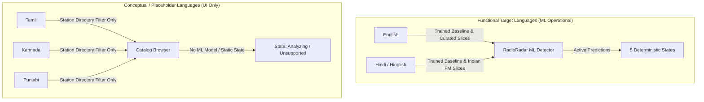

# RadioRadar: Comprehensive Dataset Research & Data Strategy

**Project:** RadioRadar  
**Milestone:** 0.3 - Dataset Research and Machine Learning Feasibility  
**Role:** Senior Machine Learning Research Engineer & Audio-Processing Specialist  
**Status:** Completed Architectural Research  

---

## 1. Executive Summary & Research Objectives

The objective of this research is to evaluate the global landscape of public audio, speech, music, and broadcast datasets to determine whether existing data can train or benchmark RadioRadar's radio advertisement detection engine, specifically for its two **functional target languages**: **English** and **Hindi**.

### Fundamental Research Findings:
1. **Zero Off-the-Shelf Labeled Radio Commercial Datasets**: There is **no publicly accessible, standardized audio dataset of labeled live radio advertisements** for either English or Hindi. Commercial Automated Content Recognition (ACR) providers (e.g., Triton Digital, Nielsen, ACRCloud) maintain closed, proprietary audio databases.
2. **Tabular Video Features vs. Raw Radio Streams**: The only notable public broadcast commercial dataset is the *UCI TV News Channel Commercial Detection Dataset* (IIIT Hyderabad, 2015). However, it provides only pre-extracted tabular features from television video shots (not raw streaming audio waveforms), making it unsuitable for training raw audio feature extractors.
3. **Speech and Music Datasets Do Not Solve Commercial Detection**: While high-quality speech and music datasets exist (e.g., MUSAN, GTZAN, Kathbath, Shrutilipi), classifying speech vs. music does not equate to detecting advertisements. An ad can consist of pure music, pure speech, or rapid speech mixed with jingles.
4. **Mandatory Custom Data Collection**: A working prototype for RadioRadar **requires** a manually curated, station-stratified audio benchmark dataset recorded directly from public radio broadcasts.
5. **Language Boundary Definition**:
   - **Functional Languages**: **English** and **Hindi** are the sole targets for ML training, feature extraction, and functional advertisement detection.
   - **Conceptual / Dummy Languages**: **Tamil**, **Kannada**, and **Punjabi** are conceptual UI placeholders to validate language-grouping catalog features in the frontend. They have zero ML models, zero training data, and zero detection capabilities in this release.

---

## 2. Comprehensive Dataset Survey

We investigated public datasets across six functional categories:
- **Category A:** Commercial Advertisement Datasets
- **Category B:** Radio Broadcast Datasets
- **Category C:** Speech and Music Classification Datasets
- **Category D:** General Audio Event Classification Datasets
- **Category E:** Multilingual Speech Datasets (English, Hindi, and Indian Languages)
- **Category F:** Promotional & Advertising Speech Corpora

---

### Category A: Commercial Advertisement Datasets

#### 1. TV News Channel Commercial Detection Dataset
- **Publisher / Institution:** International Institute of Information Technology (IIIT) Hyderabad, India (Prithviraj Sen, C. V. Jawahar et al.).
- **Official Website / URL:** `https://archive.ics.uci.edu/dataset/326/tv+news+channel+commercial+detection+dataset`
- **Source Confidence:** HIGH (Official UCI Repository & IEEE/CVPR publication).
- **Dataset Size / Duration:** ~150 hours total across 5 TV news channels (3 Indian: CNN-IBN, NDTV 24x7, Times Now; 2 International: BBC, CNN; ~30 hours per channel).
- **Instances:** ~129,685 instances corresponding to individual video shots.
- **Languages:** English and Indian English (with incidental code-switched Hindi-English broadcast segments).
- **Audio Format:** **No raw audio files provided.** Tabular ASCII text format containing 12 pre-extracted shot features (7 audio: Short-Term Energy, Zero-Crossing Rate, Spectral Centroid, Spectral Flux, Spectral Rolloff, Fundamental Frequency, MFCC Bag-of-Audio-Words; 5 visual: shot length, motion, text distribution, edge change ratio).
- **Available Annotations:** Binary class labels: `+1` (Commercial) vs. `-1` (Non-commercial / News content).
- **Explicit Ad Labels & Timestamps:** Commercials are labeled per video shot, but exact wall-clock audio timestamps are coupled to TV video shots, not continuous radio audio streams.
- **Distinguishability:** Separates commercial blocks from news anchor dialogue.
- **License / Permissions:** Open for academic research via UCI Machine Learning Repository; non-commercial research use.
- **Registration / Approval:** Free direct download via UCI / Kaggle mirrors; no registration required.
- **Practical Usability:** **Useful only for experimentation with tabular models.** Because raw audio waveforms are omitted, RadioRadar cannot use this dataset to validate its FFmpeg raw PCM decoding, sliding-window chunking, or custom NumPy feature extractors.
- **Classification:** **Useful only for experimentation.**

---

### Category B: Radio Broadcast Datasets

#### 2. RadioTalk Corpus
- **Publisher / Institution:** Massachusetts Institute of Technology (MIT) Media Lab (Lab for Social Machines; Will Brannon, Deb Roy et al.).
- **Official Website / URL:** `https://github.com/social-machines/RadioTalk` / Hosted on AWS S3 (`s3://radio-talk/v1.0/`).
- **Source Confidence:** HIGH (Official MIT GitHub & arXiv:1907.07077).
- **Dataset Size / Duration:** ~284,000 hours of broadcast talk radio audio and ASR transcripts (~2.8 billion words). Raw JSONL metadata archive is ~9.3 GB compressed.
- **Audio Format:** 16 kHz audio snippets associated with speaker turns.
- **Languages:** US English.
- **Available Annotations:** Automatic speech recognition transcripts, speaker IDs, show names, call signs, geographic location, and studio vs. telephone flags.
- **Explicit Ad Labels:** **NO.** Advertisements are **not** labeled or segmented. Commercial breaks are either transcribed as speech or omitted by the automated capture pipeline.
- **Ad Timestamps:** None.
- **License / Permissions:** Custom MIT research release. Free for academic non-commercial research.
- **Registration / Approval:** Hosted on public AWS S3 bucket; request/public download.
- **Practical Usability:** **Useful as an auxiliary negative corpus.** Provides thousands of hours of high-energy US talk-radio speech to benchmark and reduce false-positive ad triggers on spoken dialogue.
- **Classification:** **Useful for auxiliary model development.**

#### 3. Shrutilipi (All India Radio News Corpus)
- **Publisher / Institution:** AI4Bharat (IIT Madras), India.
- **Official Website / URL:** `https://github.com/AI4Bharat/Shrutilipi` / `https://huggingface.co/datasets/ai4bharat/Shrutilipi`
- **Source Confidence:** HIGH (Official AI4Bharat publication & Hugging Face repository).
- **Dataset Size / Duration:** ~6,400+ hours of multi-lingual broadcast news audio mined from Prasar Bharati's **All India Radio (AIR)** bulletins.
- **Audio Format:** 16 kHz mono WAV / MP3.
- **Languages:** 12+ Indian languages including Hindi (1,000+ hours), Tamil, Kannada, Punjabi, etc.
- **Available Annotations:** Text transcripts aligned at the sentence level from official AIR news bulletins.
- **Explicit Ad Labels:** **NO.** All India Radio news bulletins are public service broadcasts and contain virtually no commercial advertisements.
- **Ad Timestamps:** None.
- **License / Permissions:** Creative Commons Attribution 4.0 International (CC BY 4.0).
- **Registration / Approval:** Fully public download on Hugging Face / AI4Bharat portal.
- **Practical Usability:** **Extremely valuable auxiliary negative benchmark for Hindi.** It provides real-world broadcast-quality Hindi speech recorded from radio transmissions, serving as the benchmark for testing false positives on Hindi news reading.
- **Classification:** **Useful for auxiliary model development.**

---

### Category C: Speech and Music Classification Datasets

#### 4. MUSAN: A Music, Speech, and Noise Corpus (OpenSLR 17)
- **Publisher / Institution:** Center for Language and Speech Processing, Johns Hopkins University (David Snyder, Guoguo Chen, Daniel Povey).
- **Official Website / URL:** `https://www.openslr.org/17/`
- **Source Confidence:** HIGH (Official OpenSLR repository).
- **Dataset Size / Duration:** ~109 hours total (~11 GB uncompressed):
  - Speech: ~60 hours (LibriVox audiobooks, US parliamentary hearings).
  - Music: ~42 hours (various genres: classical, jazz, rock, pop).
  - Noise: ~7 hours (technical, ambient, atmospheric).
- **Number of Audio Files:** ~6,000+ files.
- **Audio Format:** 16 kHz mono 16-bit WAV files (matches RadioRadar's PCM pipeline).
- **Languages:** English predominates in speech; multi-lingual samples included.
- **Available Annotations:** Categorical folder hierarchy (`speech/`, `music/`, `noise/`) with subgenre/speaker metadata.
- **Explicit Ad Labels:** **NO.** Contains no commercial advertisements.
- **Ad Timestamps:** None.
- **Distinguishability:** Perfect ground truth for binary speech vs. music vs. ambient noise discrimination.
- **License / Permissions:** Creative Commons Attribution 4.0 International (CC BY 4.0). Subsets map to public domain / CC-BY. Permitted for academic and commercial use with attribution.
- **Registration / Approval:** Free direct download via HTTP; no registration.
- **Practical Usability:** **Essential baseline auxiliary dataset.** Allows rigorous local validation of the pure NumPy/SciPy acoustic feature extractor (MFCCs, spectral centroid, ZCR, RMS) to ensure that RadioRadar's pipeline accurately separates pure music from spoken dialogue.
- **Classification:** **Useful for auxiliary model development.**

#### 5. GTZAN Music/Speech Collection
- **Publisher / Institution:** George Tzanetakis (Princeton University / Marsyas Framework).
- **Official Website / URL:** `http://marsyas.info/downloads/datasets.html` / Mirror via TensorFlow Datasets `gtzan_music_speech`.
- **Source Confidence:** HIGH (Standard MIR benchmark literature).
- **Dataset Size / Duration:** 120 audio tracks (60 speech, 60 music), each exactly 30 seconds long (total 60 minutes).
- **Audio Format:** 22,050 Hz 16-bit mono WAV.
- **Languages:** English speech.
- **Available Annotations:** Binary class: `music` vs. `speech`.
- **Explicit Ad Labels:** **NO.**
- **License / Permissions:** Open for educational and academic research.
- **Registration / Approval:** Public direct download.
- **Practical Usability:** Small, lightweight test set for quick sanity checks during unit testing of feature extraction algorithms.
- **Classification:** **Useful only for experimentation.**

---

### Category D: General Audio Event Classification Datasets

#### 6. Google AudioSet
- **Publisher / Institution:** Google Research (Jort F. Gemmeke et al.).
- **Official Website / URL:** `https://research.google.com/audioset/`
- **Source Confidence:** HIGH (Official Google Research portal & IEEE ICASSP publication).
- **Dataset Size / Duration:** 2.1 million 10-second audio clips extracted from YouTube videos (~5,800 hours), mapped across an ontology of 632 audio event classes.
- **Languages:** Global / Multilingual (predominantly English in spoken subsets).
- **Audio Format:** Extracted 16-bit 16 kHz FLAC/WAV or pre-extracted 128-dimensional VGGish embeddings.
- **Available Annotations:** Multi-label ontological tags per 10-second clip.
- **Advertisement Tags:**
  - `Jingle (music)` (Class ID `/m/02gzf6`): Defined as *"A short song or tune used in advertising and for other commercial uses."*
  - **No dedicated class for "Commercial" or "Radio Advertisement"**.
- **Ad Timestamps:** Start/end timestamps exist for YouTube clip segments, but not intra-clip ad boundaries.
- **License / Permissions:** Annotations released under Creative Commons Attribution 4.0 (CC BY 4.0); underlying audio remains under YouTube copyright.
- **Registration / Approval:** Open download of annotation CSVs; audio clips require downloading from YouTube via `yt-dlp` (broken links due to video deletions).
- **Practical Usability:** The `Jingle (music)` class can provide positive training examples of commercial musical hooks, but AudioSet cannot serve as a continuous stream ad benchmark.
- **Classification:** **Useful for auxiliary model development.**

---

### Category E: Multilingual Speech Datasets (English & Hindi)

#### 7. Kathbath (AI4Bharat)
- **Publisher / Institution:** AI4Bharat (IIT Madras), India.
- **Official Website / URL:** `https://github.com/AI4Bharat/indic-superb` / Hugging Face `ai4bharat/kathbath`
- **Source Confidence:** HIGH (Official AI4Bharat publication & Bhashini national platform).
- **Dataset Size / Duration:** ~1,684 hours of human-labeled read speech across 12 Indian languages (~150 hours for Hindi).
- **Audio Format:** 16 kHz mono WAV.
- **Languages:** Hindi, Tamil, Kannada, Punjabi, Bengali, Gujarati, Malayalam, Marathi, Odia, Sanskrit, Telugu, Urdu.
- **Available Annotations:** High-accuracy human-verified text transcripts.
- **Explicit Ad Labels:** **NO.** Contains zero commercial advertising content.
- **License / Permissions:** Creative Commons Attribution-ShareAlike 4.0 (CC BY-SA 4.0).
- **Registration / Approval:** Free public download via Hugging Face.
- **Practical Usability:** High-quality clean Hindi speech baseline to verify speech acoustic properties and train negative non-ad speech detectors.
- **Classification:** **Useful for auxiliary model development.**

#### 8. Mozilla Common Voice (English & Hindi)
- **Publisher / Institution:** Mozilla Foundation.
- **Official Website / URL:** `https://commonvoice.mozilla.org/`
- **Source Confidence:** HIGH (Official Mozilla repository).
- **Dataset Size / Duration:**
  - English (v15.0+): 3,000+ hours.
  - Hindi (v15.0+): ~30 hours of verified speech.
- **Audio Format:** 48 kHz / 16 kHz MP3/WAV.
- **Languages:** English and Hindi.
- **Available Annotations:** Crowdsourced text transcripts, upvotes/downvotes, speaker demographic metadata.
- **Explicit Ad Labels:** **NO.** Sentence-level read speech only.
- **License / Permissions:** Creative Commons Zero (CC0 - Public Domain Dedication).
- **Registration / Approval:** Free download requiring agreement to Mozilla terms.
- **Practical Usability:** Clean reference audio for synthesizing mixed speech/music audio clips for augmentation.
- **Classification:** **Useful only for experimentation.**

#### 9. MUCS / OpenSLR 104 (Hindi-English Code-Switching ASR Corpus)
- **Publisher / Institution:** Multilingual and Code-Switching ASR Challenge (IIT Dharwad, IIT Madras, Microsoft).
- **Official Website / URL:** `https://www.openslr.org/104/`
- **Source Confidence:** HIGH (Official OpenSLR repository).
- **Dataset Size / Duration:** ~90 hours training, ~5 hours evaluation of Hindi-English code-switched speech extracted from technical lectures.
- **Audio Format:** 16 kHz mono 16-bit WAV.
- **Languages:** Hindi-English code-switched (Hinglish).
- **Available Annotations:** Orthographic word-level transcripts in Devanagari and Latin scripts with language tags.
- **Explicit Ad Labels:** **NO.**
- **License / Permissions:** Creative Commons Attribution 4.0 (CC BY 4.0).
- **Registration / Approval:** Public direct download via OpenSLR.
- **Practical Usability:** Essential for studying acoustic transitions in Hinglish speech. Does not provide ad labels, but models acoustic properties of bilingual Indian speakers.
- **Classification:** **Useful for auxiliary model development.**

---

### Category F: Promotional Speech & Open Radio Datasets

#### 10. rvdmaazen/Radio-Audio-Classification (Community Benchmark)
- **Publisher / Institution:** Community Open-Source Project (GitHub: `rvdmaazen/Radio-Audio-Classification`).
- **Official Website / URL:** `https://github.com/rvdmaazen/Radio-Audio-Classification`
- **Source Confidence:** MEDIUM (Independent open-source developer project; verified repository).
- **Dataset Size / Duration:** ~10 hours of continuous audio captured across 11 live radio stations.
- **Audio Format:** MP3 / WAV.
- **Languages:** Dutch / International English.
- **Available Annotations:** Binary segments labeled as `music` vs. `advertisements / other`.
- **Explicit Ad Labels:** **YES.** Advertisements are explicitly identified.
- **Ad Timestamps:** Start and end timestamps provided in segmentation metadata.
- **License / Permissions:** MIT License on repository; recorded broadcast clips are for educational fair use.
- **Registration / Approval:** Direct clone from GitHub.
- **Practical Usability:** Demonstrates that training a lightweight classifier directly on sliced radio streams is technically viable. However, its small size and Dutch focus mean it cannot serve as the operational model for English and Hindi.
- **Classification:** **Useful for auxiliary model development.**

---

## 3. Systematic Dataset Evaluation Matrix

The following matrix synthesizes the 10 surveyed datasets against all 17 investigative parameters:

| Parameter | 1. UCI Commercial | 2. RadioTalk | 3. Shrutilipi | 4. MUSAN | 5. GTZAN M/S | 6. AudioSet | 7. Kathbath | 8. Common Voice | 9. OpenSLR 104 | 10. Radio-Audio |
|---|---|---|---|---|---|---|---|---|---|---|
| **Official Name** | TV News Commercial | RadioTalk | Shrutilipi | MUSAN (SLR17) | GTZAN M/S | AudioSet | Kathbath | Common Voice | MUCS (SLR104) | Radio-Audio |
| **Publisher** | IIIT Hyderabad | MIT Media Lab | AI4Bharat | JHU CLSP | G. Tzanetakis | Google Research | AI4Bharat | Mozilla | IIT / Microsoft | Community |
| **Official URL** | [archive.ics.uci.edu](https://archive.ics.uci.edu/dataset/326/) | [github.com/social-machines](https://github.com/social-machines/RadioTalk) | [github.com/AI4Bharat](https://github.com/AI4Bharat/Shrutilipi) | [openslr.org/17](https://www.openslr.org/17/) | [marsyas.info](http://marsyas.info/) | [research.google.com](https://research.google.com/audioset/) | [github.com/AI4Bharat](https://github.com/AI4Bharat/indic-superb) | [commonvoice.mozilla.org](https://commonvoice.mozilla.org/) | [openslr.org/104](https://www.openslr.org/104/) | [github.com/rvdmaazen](https://github.com/rvdmaazen) |
| **Dataset Size** | 129,685 instances | ~9.3 GB (metadata) | ~500 GB | ~11 GB | ~300 MB | ~100 GB (CSV/Feat) | ~150 GB | ~80 GB | ~12 GB | ~2 GB |
| **Duration** | 150 hours | 284,000 hours | 6,400+ hours | 109 hours | 1 hour (120 trk) | 5,800 hours | 1,684 hours | 3,000+ h (EN) | 95 hours | 10 hours |
| **Audio Format** | **None (Tabular)** | 16 kHz WAV | 16 kHz WAV/MP3 | 16 kHz WAV | 22.05 kHz WAV | 16 kHz / VGGish | 16 kHz WAV | 16/48 kHz MP3 | 16 kHz WAV | 16 kHz MP3/WAV |
| **Languages** | EN / In-EN | US English | 12+ Indic (Hi) | EN / Multi | English | Multi (Global) | 12 Indic (Hi) | EN, Hindi | Hindi-English | Dutch / English |
| **Explicit Ad Labels** | **YES (+1 / -1)** | **NO** | **NO** | **NO** | **NO** | Partial (Jingle) | **NO** | **NO** | **NO** | **YES** |
| **Ad Timestamps** | Shot-level only | None | None | None | None | Clip-level only | None | None | None | **YES** |
| **Music/Speech/Talk** | Yes (shot) | Talk only | News only | Yes (Separate) | Yes (Separate) | Yes (Ontology) | Speech only | Speech only | Speech only | Yes (Ad vs Mus) |
| **License** | Open Research | MIT Research | CC BY 4.0 | CC BY 4.0 | Academic / Open | CC BY 4.0 | CC BY-SA 4.0 | CC0 | CC BY 4.0 | MIT / Fair Use |
| **Academic Use** | Permitted | Permitted | Permitted | Permitted | Permitted | Permitted | Permitted | Permitted | Permitted | Permitted |
| **Commercial Use** | Restricted | Restricted | Permitted | Permitted | Restricted | Permitted | Permitted | Permitted | Permitted | Ambiguous |
| **Registration** | Not required | S3 / Open | Free (HF) | Not required | Not required | YouTube scraping | Free (HF) | Terms Agree | Not required | Not required |
| **Downloadable** | Easily | High bandwidth | High bandwidth | Easily | Easily | Complex / Partial | Easily | High bandwidth | Easily | Easily |
| **Source Confidence**| **HIGH** | **HIGH** | **HIGH** | **HIGH** | **HIGH** | **HIGH** | **HIGH** | **HIGH** | **HIGH** | **MEDIUM** |
| **Utility Classification** | **Experimentation**| **Auxiliary** | **Auxiliary** | **Auxiliary** | **Experimentation**| **Auxiliary** | **Auxiliary** | **Experimentation**| **Auxiliary** | **Auxiliary** |

---

## 4. English and Hindi Audio & Advertising Data Availability

### 4.1. The English Data Landscape
- **Availability Status**: Moderate availability of auxiliary speech, music, and podcast recordings, but **zero public radio ad datasets**.
- **Acoustic Characteristics of Western Radio Ads**:
  - Pacing: Rapid conversational delivery (180–220 words per minute vs. 130–150 wpm in news).
  - Dynamic Range: Aggressive multi-band peak limiting ("loudness war" broadcast mastering), resulting in near-zero crest factor.
  - Structure: Crisp 15, 30, or 60-second standard spot lengths bounded by 100–300ms micro-silences.

### 4.2. The Hindi Data Landscape
- **Availability Status**: Critical scarcity. There is **no publicly accessible radio advertising dataset in Hindi**. Existing Indian audio corpora (Shrutilipi, Kathbath, MUCS) focus strictly on speech recognition for news reading and technical lectures.
- **Acoustic & Cultural Realities of Indian Radio Ads**:
  1. **Extreme Musicality (Jingle Density)**: Unlike Western spoken commercials, a substantial proportion of Indian radio commercials are built around original or parody musical jingles featuring Bollywood-style orchestration (synthesizers, dholak, tabla, acoustic guitar). Pure acoustic classifiers routinely confuse these with standard Bollywood music tracks.
  2. **Vocal Modulation & Dramatization**: Voice actors adopt exaggerated comedic, emotional, or authoritative tonal registers that diverge sharply from conversational speech.
  3. **Heavy Dynamic Compression**: Indian private FM stations (Radio Mirchi, Red FM, Big FM) apply aggressive audio processing (e.g., Omnia/Orban audio processors) to maximize loudness.

### 4.3. Code-Switching (Hinglish) Advertising
- **Operational Reality**: Radio advertising in urban and semi-urban India is predominantly **code-switched (Hinglish)**. Ads typically use Hindi grammar interleaved with English brand names, taglines, URLs, phone numbers, and call-to-actions (e.g., *"Aaj hi download karein hamara app aur paayein flat fifty percent discount"*).
- **Acoustic Implications**:
  - Acoustic feature extraction (MFCCs, spectral roll-off, zero-crossing rate) does **not** decode vocabulary; it measures vocal tract resonances and energy distribution.
  - Code-switching produces abrupt phonetic shifts at English/Hindi boundaries (e.g., aspirated retroflex consonants transitioning into alveolar English stops), altering spectral flux.
  - **Architectural Policy**: RadioRadar’s acoustic model must not attempt to separate Hindi from English. Instead, it must be trained on authentic Indian FM broadcast segments where code-switched advertising is treated as a single unified functional class (`ADVERTISEMENT`).

---

## 5. Field Boundary: Functional vs. Conceptual Languages

To maintain strict scientific and technical credibility, RadioRadar enforces an explicit distinction between supported functional languages and placeholder UI categories:



| Language | Role in RadioRadar | Functional ML Status | Dataset Availability | Operational Claim |
|---|---|---|---|---|
| **English** | **Primary Functional** | **Active ML Target** | Curated radio recordings + MUSAN baseline. | Advertisements evaluated via acoustic feature pipeline. |
| **Hindi** | **Primary Functional** | **Active ML Target** | Curated Indian FM recordings + Shrutilipi negatives. | Advertisements (including Hinglish) evaluated via acoustic pipeline. |
| **Tamil** | **Conceptual / Dummy** | **NO ML Model** | Zero ad training data collected. | Station browsing placeholder only; **never claim detection works**. |
| **Kannada** | **Conceptual / Dummy** | **NO ML Model** | Zero ad training data collected. | Station browsing placeholder only; **never claim detection works**. |
| **Punjabi** | **Conceptual / Dummy** | **NO ML Model** | Zero ad training data collected. | Station browsing placeholder only; **never claim detection works**. |

---

## 6. Practical Data Collection Strategy: The "RadioRadar-10h" Benchmark

Because no suitable labeled training dataset exists, RadioRadar must establish an initial, manually curated benchmark dataset (**RadioRadar-10h**) across English and Hindi streams.

### 6.1. Audio Stream Acquisition Protocol
1. **Public Stream Sampling**: Capture live streams from 10 distinct, high-uptime public stations (5 English, 5 Hindi) using automated FFmpeg recorders:
   - *English Stations*: BBC World Service, NPR News, Capital FM, LBC London, Radio New Zealand.
   - *Hindi Stations*: Radio Mirchi 98.3, AIR Vividh Bharati, Red FM, Radio City Hindi, Big FM.
2. **Standardized Audio Ingestion**: Record audio at 16,000 Hz, 16-bit, single-channel (mono) PCM WAV to match the production inference pipeline exactly.
3. **Recording Cadence**: Capture two 60-minute blocks per station (one during peak drive-time 08:00–10:00 local time, one during mid-day 13:00–15:00 local time) across multiple days to ensure diverse commercial blocks.

### 6.2. Ground Truth Annotation Schema
Audio recordings are segmented into contiguous, non-overlapping intervals in Audacity or via an automated Python labeling tool.

#### Taxonomy of Labels:
- `ADVERTISEMENT`: Paid promotional announcements, commercial spots, sponsor messages, promotional station jingles with product pitches.
- `MUSIC`: Continuous songs, orchestral tracks, album tracks without vocal interruptions.
- `TALK`: News reading, interview dialogue, phone-in banter, sports commentary, DJ banter without commercial intent.
- `NEWS`: Formal news bulletins and weather announcements.
- `OTHER`: Station identification stingers, chimes, test tones, ambient noise.
- `UNCERTAIN`: Ambiguous segments (e.g., DJ reading a sponsored contest brief over background music).

#### Annotation Record Schema (JSONL / CSV):
```json
{
  "recording_id": "RR-REC-20261114-001",
  "station_id": "in-radio-mirchi",
  "station_name": "Radio Mirchi 98.3",
  "language": "hi",
  "start_timestamp_ms": 142500,
  "end_timestamp_ms": 172500,
  "duration_ms": 30000,
  "class_label": "ADVERTISEMENT",
  "sub_type": "jingle_with_voiceover",
  "is_code_switched": true,
  "annotator_id": "annotator_01",
  "verification_status": "double_verified",
  "license": "Educational Research Fair Use",
  "provenance_url": "https://stream.radiomirchi.com/live"
}
```

### 6.3. Prevention of Data Leakage (Station-Level Splitting)
A critical methodological trap in broadcast ML is **station-level overfitting**. If models are trained and tested on slices from the same station recorded on the same day, the classifier learns station-specific EQ curves, compression profiles, or recurring DJ voices rather than generalized commercial characteristics.

**Mandatory Partitioning Strategy**:
- **Training Set (60%)**: 3 English stations, 3 Hindi stations.
- **Validation Set (20%)**: Slices from training stations on distinct calendar days (for hyperparameter tuning).
- **Held-Out Test Set (20%)**: **2 unseen English stations and 2 unseen Hindi stations**. The model must be evaluated on stations it has never encountered during training.

---

## 7. Recommended Initial Dataset Plan

| Dataset Component | Source | Target Duration | Languages | Primary Purpose |
|---|---|---|---|---|
| **RadioRadar-10h (Core Benchmark)** | Curated public stream recordings | ~10 hours (6h EN, 4h HI) | English, Hindi (Hinglish) | Primary training, validation, and held-out test split for ad detection. |
| **MUSAN (Speech & Music)** | OpenSLR 17 (JHU) | ~10 hours subset | English, Multi | Auxiliary baseline for pure speech vs. pure music feature validation. |
| **Shrutilipi News Subset** | AI4Bharat / AIR | ~5 hours subset | Hindi | Difficult negative samples (formal Hindi broadcast news). |
| **RadioTalk Subset** | MIT Media Lab | ~5 hours subset | English | Difficult negative samples (US conversational talk radio). |

---

## 8. Summary of Research Verification

- **Directly Usable Public Ad Datasets for Live Radio**: **0 found globally.**
- **Identified Viable Auxiliary Datasets**: 4 verified (MUSAN, Shrutilipi, Kathbath, AudioSet Jingle class).
- **Core Recommendation**: RadioRadar must build the lightweight **RadioRadar-10h** benchmark corpus before deploying or claiming ML accuracy.
