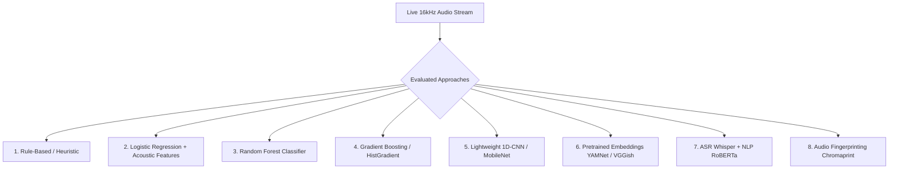

# RadioRadar: Machine Learning Experiment Plan & Feasibility Analysis

**Project:** RadioRadar  
**Milestone:** 0.3 - Dataset Research and Machine Learning Feasibility  
**Role:** Senior Machine Learning Research Engineer & Audio-Processing Specialist  
**Status:** Completed Experimental Specification  

---

## 1. Problem Formulation & Detection Challenge

The core objective of RadioRadar is to detect when an internet radio stream transitions from regular broadcast programming (music, news, talk-show dialogue) into commercial advertising blocks, emitting one of five deterministic monitoring states:
- `Advertisement detected`
- `No advertisement detected`
- `Analyzing`
- `Uncertain`
- `Unavailable`

### Operational Constraints & Boundaries:
- **Audio Stream**: Live HTTP progressive audio (MP3/AAC) ingested via FFmpeg, decoded to single-channel (mono) 16,000 Hz 32-bit floating-point PCM.
- **Latency Target**: Near real-time end-to-end detection latency within **6 to 12 seconds** of commercial onset (balancing buffer accumulation and temporal smoothing).
- **Compute Envelope**: **512 MB RAM** and **0.1 fractional vCPU** on Render Free Tier.
- **Supported Functional Languages**: **English** and **Hindi** (including code-switched Hinglish). Conceptual placeholder languages (Tamil, Kannada, Punjabi) have **zero active ML models**.

---

## 2. In-Depth Comparison of Machine Learning Approaches

We evaluated eight distinct algorithmic approaches against computational constraints, data requirements, and classification efficacy:



### Approach 1: Rule-Based & Heuristic Detection
- **Mechanism**: Monitors stream metadata (ICY headers) for ad insertion tags, tracks sudden spikes in short-term RMS energy (dynamic range compression), and measures prolonged speech after continuous music or silence boundaries ($>200\text{ms}$).
- **Data Required**: None (hand-tuned thresholds).
- **Can it distinguish ads from ordinary speech?**: **No.** Fails completely on talk radio, news broadcasts, and podcasts where continuous speech is normal programming.
- **Resource Footprint**: Minimal CPU ($<1\%$), negligible RAM ($<1\text{ MB}$), zero model storage.
- **Strengths**: Zero cold-start latency, zero training overhead, provides instantaneous metadata-based ad detection when explicit station tags are present.
- **Weaknesses**: Extremely brittle; most community streams strip ad metadata; high false-positive rates on speech.
- **Suitability for 0.1 CPU**: **Excellent.**
- **Verdict for Student MVP**: **Essential as Tier 1 auxiliary heuristic**, but insufficient as a standalone detector.

---

### Approach 2: Logistic Regression using Acoustic Features
- **Mechanism**: Extracts 32 low-level acoustic features (MFCCs, RMS, ZCR, spectral centroid, rolloff, flatness) over a 2.5-second sliding window and applies an $L_2$-regularized linear decision boundary:
  $$P(\text{ad}) = \sigma(\mathbf{w}^T \mathbf{x} + b)$$
- **Data Required**: Small labeled feature dataset (~500–2,000 annotated windows).
- **Can it distinguish ads from ordinary speech?**: **Poorly.** Linear hyperplanes struggle with non-linear acoustic overlaps between energetic DJ speech and commercial voiceovers.
- **Resource Footprint**: Minimal CPU ($<2\text{ms}$ per inference step), $<5\text{ MB}$ RAM, model size $<50\text{ KB}$.
- **Strengths**: Deterministic, ultra-fast, zero risk of CPU starvation on 0.1 vCPU, transparent feature weights.
- **Weaknesses**: High false-positive rate on talk radio; incapable of capturing non-linear feature interactions (e.g., speech occurring simultaneously over music).
- **Suitability for 0.1 CPU**: **Ideal.**
- **Verdict for Student MVP**: **Mandatory linear baseline** to establish the lower bound of acoustic performance.

---

### Approach 3: Random Forest Classifier
- **Mechanism**: An ensemble of decorrelated decision trees trained on acoustic feature vectors. Outputs calibrated class probabilities via leaf voting.
- **Data Required**: Moderate labeled dataset (~2,000–10,000 annotated audio windows).
- **Can it distinguish ads from ordinary speech?**: **Moderately.** Captures non-linear thresholds (e.g., high RMS + elevated high-frequency spectral rolloff + high zero-crossing rate = commercial jingle voiceover). However, energetic radio hosts still trigger false positives.
- **Resource Footprint**:
  - *Estimates*: 20–50 trees, `max_depth=8` consumes ~15–25 MB RAM and 5–15ms CPU inference time.
  - *Unconstrained Danger*: A default Scikit-learn Random Forest with 200+ deep trees can exceed 80 MB RAM and spike CPU on inference.
- **Strengths**: Robust to outliers, handles correlated acoustic features (MFCCs), fast tabular inference, easy serialization via `joblib`.
- **Weaknesses**: Cannot model temporal sequence transitions across frames without sliding memory buffers.
- **Suitability for 0.1 CPU**: **Feasible only if strictly constrained** (`n_estimators=30–50`, `max_depth=8`, `n_jobs=1`).
- **Verdict for Student MVP**: **Recommended primary baseline classifier**.

---

### Approach 4: Gradient Boosted Decision Trees (HistGradientBoosting / LightGBM)
- **Mechanism**: Sequentially builds shallow trees optimizing cross-entropy loss, using histogram binning for fast numerical feature evaluation.
- **Data Required**: Moderate labeled dataset.
- **Can it distinguish ads from ordinary speech?**: Similar to Random Forest, with slightly better boundary calibration for ambiguous samples.
- **Resource Footprint**: Model size $<500\text{ KB}$, RAM ~15 MB, inference $<5\text{ms}$.
- **Strengths**: Faster inference and smaller memory footprint than Random Forest of equal accuracy; native support for missing values.
- **Weaknesses**: More sensitive to noisy labels in small student datasets.
- **Suitability for 0.1 CPU**: **Very Good.**
- **Verdict for Student MVP**: **Top candidate model** to evaluate against Random Forest during Milestone 4 experiments.

---

### Approach 5: Lightweight Neural Audio Classifiers (1D-CNN / MobileNetV3)
- **Mechanism**: Mel-spectrogram patches ($128 \times 128$) fed into depthwise separable convolutional layers to learn spatial-temporal acoustic textures.
- **Data Required**: Large labeled audio dataset (50+ hours).
- **Can it distinguish ads from ordinary speech?**: Superior representation of musical jingles and voiceover transitions.
- **Resource Footprint**:
  - *PyTorch / ONNX Runtime*: Base library import consumes **150MB–250MB RAM**.
  - *CPU Inference*: 50–150ms per frame on 0.1 vCPU (risks CPU thread exhaustion).
- **Strengths**: High acoustic discriminatory power without manual feature engineering.
- **Weaknesses**: PyTorch dependencies risk instant OOM on Render 512MB RAM; high training complexity; prone to overfitting on small datasets.
- **Suitability for 0.1 CPU**: **Unsuitable / High Risk on Free Tier.**
- **Verdict for Student MVP**: **Postpone to post-MVP / Paid Tier.**

---

### Approach 6: Pretrained Audio Embeddings (YAMNet / VGGish / OpenL3)
- **Mechanism**: Feeds raw audio into a pre-trained frozen neural network (e.g. YAMNet on AudioSet) to extract 1024-dimensional embeddings, followed by a lightweight linear classifier.
- **Data Required**: Small fine-tuning dataset (~5 hours).
- **Can it distinguish ads from ordinary speech?**: Excellent at identifying underlying events (jingle, speech, singing, cheer, applause).
- **Resource Footprint**: TensorFlow Lite runtime requires ~80–120 MB RAM; embedding extraction takes ~40–80ms per window on throttled CPU.
- **Strengths**: Excellent transfer learning from millions of audio clips.
- **Weaknesses**: TF-Lite / ONNX dependency overhead; embedding computation pushes 0.1 vCPU near saturation when decoding audio concurrently.
- **Suitability for 0.1 CPU**: **Marginal / High Latency.**
- **Verdict for Student MVP**: **Deferred.**

---

### Approach 7: Speech Recognition (ASR) + NLP Transcript Classification
- **Mechanism**: Transcribes spoken audio to text in real time using an ASR engine (e.g. Whisper-tiny, Vosk) and analyzes transcripts using an NLP classifier (e.g. RoBERTa or keyword matching for promotional phrases, phone numbers, discounts, URLs).
- **Data Required**: Large multi-lingual ASR training corpus; text-classification dataset.
- **Can it distinguish ads from ordinary speech?**: **State of the Art (as demonstrated by RadIA, arXiv:2403.03538).** Easily separates news/interviews from commercial pitches because it understands semantic intent.
- **Resource Footprint**:
  - *RAM*: Whisper-tiny requires **800MB–1.5GB RAM** (guaranteed instant OOM kill on Render 512MB free tier).
  - *CPU*: Real-time transcription requires 1.0+ full vCPU cores. On a 0.1 vCPU, 5 seconds of audio takes 25–40 seconds to transcribe.
- **Suitability for 0.1 CPU**: **COMPLETELY IMPOSSIBLE on Free Tier.**
- **Verdict for Student MVP**: **Strictly Deferred to Dedicated Paid GPU/CPU Infrastructure.**

---

### Approach 8: Audio Fingerprinting & Repeated-Content Detection
- **Mechanism**: Computes landmark hashes (e.g. Chromaprint / Dejavu peak pairs) from audio streams. Because radio commercials are broadcast repeatedly (often 4–10 times daily across stations), repeated identical audio segments are clustered and identified as commercials.
- **Data Required**: Unlabeled continuous audio streams accumulated over 48–72 hours.
- **Can it distinguish ads from ordinary speech?**: **Yes, for repeated commercial spots.** Also catches syndicated news intros, recurring station IDs, and repeated hit songs.
- **Resource Footprint**: Hashing is lightweight (NumPy peak detection: $<10\text{ms}$), but storing hash tables requires a persistent database (incompatible with ephemeral free-tier disk).
- **Strengths**: Language-agnostic, zero manual annotation required, 100% precision on exact repeated audio spots.
- **Weaknesses**: Blind to new, unindexed commercials (zero-shot ad detection impossible); cannot run on an ephemeral filesystem that wipes hash tables on spin-down.
- **Suitability for 0.1 CPU**: **Feasible algorithmically, but blocked by ephemeral storage on free tier.**
- **Verdict for Student MVP**: **Deferred to Phase 2 (Persistent Database Architecture).**

---

## 3. Systematic Approach Comparison Matrix

| Approach | Working Principle | Data Required | Can Distinguish Ad vs Speech? | Estimated RAM | Estimated CPU on 0.1 vCPU | Model Storage | Multilingual (EN/HI) | 0.1 CPU Viable? | Student MVP Recommendation |
|---|---|---|---|---|---|---|---|---|---|
| **1. Rule-Based** | Metadata + RMS threshold | None | No (Fails on talk) | $<2$ MB | $<1\%$ | 0 KB | Agnostic | **Yes** | **Include as Tier 1** |
| **2. Logistic Regression** | Linear hyperplane on MFCC/RMS | Small (~1k samples) | Poorly | $<10$ MB | $<2$ ms | $<50$ KB | Good (Acoustic) | **Yes** | **Include as Baseline** |
| **3. Random Forest** | Constrained tree ensemble | Moderate (~5k samples) | Moderately | ~20 MB | ~10 ms | $<4$ MB | Good (Acoustic) | **Yes** | **Recommended Primary** |
| **4. Gradient Boosting** | Histogram boosted trees | Moderate (~5k samples) | Moderately | ~15 MB | ~5 ms | $<1$ MB | Good (Acoustic) | **Yes** | **Evaluate as Candidate**|
| **5. Lightweight CNN** | 2D Mel-Spectrogram ConvNet | Large (50+ hours) | Good | ~180 MB | ~80 ms | ~15 MB | Moderate | **High Risk** | **Postpone** |
| **6. Audio Embeddings** | Frozen YAMNet / TF-Lite | Small fine-tuning | Good | ~120 MB | ~60 ms | ~25 MB | Moderate | **Marginal** | **Postpone** |
| **7. ASR + NLP** | Whisper transcribe + text clf | Enormous (ASR) | **Best (Semantic)** | $>1$ GB | $>2000$ ms | $>200$ MB | Language-dependent | **No (OOM)** | **Strictly Defer** |
| **8. Fingerprinting** | Repeated landmark hashing | Continuous stream | Yes (if repeated) | ~60 MB | ~15 ms | Requires DB | **Universal** | **Needs Disk** | **Defer to Phase 2** |

---

## 4. Recommended MVP Detection Pipeline: A Hybrid Multi-Stage Architecture

Given that pure acoustic classifiers struggle with spoken dialogue and deep learning / ASR is impossible under Render's 512MB RAM / 0.1 CPU constraints, RadioRadar must implement a **Hybrid 5-Stage Pipeline**:

```mermaid
graph TD
    subgraph "Stage 1: Stream Ingestion & Metadata (0-10ms)"
        AudioIn[Raw Audio Chunk] --> ICYCheck{ICY Metadata Clue?}
        ICYCheck -- "Ad / Commercial" Tag --> ForceAd[State: Advertisement detected]
        ICYCheck -- No Tag / Standard --> AudioBuffer[10s Rolling Circular Buffer]
    end

    subgraph "Stage 2: Acoustic Feature Extraction (15ms)"
        AudioBuffer --> Window[2.5s Frame / 0.75s Step]
        Window --> Extractor[NumPy / SciPy Feature Engine]
        Extractor --> FeatVec["32-Dim Vector: MFCCs, RMS, ZCR, Spec Rolloff, Pause Ratio"]
    end

    subgraph "Stage 3: Calibrated Classification (5ms)"
        FeatVec --> Model[Constrained Random Forest / HistGradient]
        Model --> RawProb["P(ad) in [0.0, 1.0]"]
    end

    subgraph "Stage 4: Temporal Smoothing & Hysteresis (Instant)"
        RawProb --> ProbRing[6-Frame Probability History (4.5s)]
        ProbRing --> HysteresisFilter{Weighted Consensus}
        HysteresisFilter -- "P >= 0.70 for >= 3.0s" --> StableAd[State: Advertisement detected]
        HysteresisFilter -- "P <= 0.35 for >= 3.0s" --> StableProg[State: No advertisement detected]
        HysteresisFilter -- "0.35 < P < 0.70" --> StableUncert[State: Uncertain]
        HysteresisFilter -- "Buffer < 5.0s" --> StableAnal[State: Analyzing]
    end

    subgraph "Stage 5: State Delivery"
        StableAd --> WSBroadcast[WebSocket State Broadcaster]
        StableProg --> WSBroadcast
        StableUncert --> WSBroadcast
        StableAnal --> WSBroadcast
    end
```

### Feature Evaluation & Critical Limitations:
1. **MFCCs (13 coefficients + 13 deltas)**: Captures vocal tract shape and differentiates harmonic instruments from human vocal formants. *Limitation*: Cannot distinguish commercial speech from news speech without semantic text parsing.
2. **RMS Energy & Crest Factor**: Detects extreme dynamic range compression typical of radio ads. *Limitation*: Modern pop radio stations master all music and DJ segments at near-maximum loudness, diluting this signal.
3. **Zero Crossing Rate (ZCR) & Variance**: Detects unvoiced fricatives and rapid phoneme transitions. *Limitation*: Highly sensitive to background audio noise and transmission bitrate artifacts.
4. **Spectral Centroid & Rolloff**: Measures high-frequency energy concentration (bright advertising jingles vs. warm conversational speech). *Limitation*: Varies by station broadcast equalization curves.
5. **Silence & Micro-pause Density**: Detects 150–350ms boundary pauses between commercials. *Limitation*: Fast-paced talk radio hosts frequently speak with minimal pauses, mimicking back-to-back commercials.
6. **Synthesis**: **No single feature is sufficient alone.** Combining 32 normalized acoustic features into a non-linear tree model with temporal hysteresis is the minimum viable approach.

---

## 5. Experimental Validation Plan

To validate RadioRadar empirically before full deployment, we define a repeatable, scientific experiment.

### 5.1. Dataset Preparation & Partitioning
- **Audio Corpus**: The **RadioRadar-10h** curated benchmark (5 English stations, 5 Hindi stations; 10 total hours).
- **Partitioning Protocol (Station-Level Splitting)**:
  - *Train Split (60%)*: 3 English stations (BBC World Service, NPR News, Capital FM), 3 Hindi stations (Radio Mirchi, Red FM, AIR Vividh Bharati).
  - *Validation Split (20%)*: Distinct calendar day recordings from the same training stations (used exclusively for threshold and hyperparameter tuning).
  - *Held-Out Test Split (20%)*: **2 unseen English stations (LBC London, Radio New Zealand) and 2 unseen Hindi stations (Radio City Hindi, Big FM)**. The model must be evaluated on stations it has never encountered during training to prevent station-specific overfitting.

### 5.2. Baseline vs. Candidate Model Suite
1. **Baseline 1 (Majority Class / Dummy)**: Always predicts `No advertisement detected` to establish the trivial accuracy floor.
2. **Baseline 2 (Heuristic Threshold)**: Flags an ad if RMS energy $> -12\text{ dBFS}$ and micro-pause count $> 3$ in a 5-second window.
3. **Baseline 3 (Regularized Logistic Regression)**: Standardized acoustic features with $L_2$ regularization.
4. **Candidate Model A (Constrained Random Forest)**: `n_estimators=40`, `max_depth=8`, `min_samples_split=10`.
5. **Candidate Model B (HistGradientBoosting)**: `max_iter=50`, `max_depth=6`, `learning_rate=0.08`.

### 5.3. Mandatory Evaluation Metrics
Because commercial segments occupy a minority of broadcast time (~15–25% on commercial stations, 0% on public service stations), **accuracy alone is completely misleading** (a dummy model predicting "no ad" achieves 80% accuracy).

The evaluation must compute:
1. **Class-Specific Precision & Recall**:
   $$\text{Precision}_{\text{ad}} = \frac{TP}{TP + FP}, \quad \text{Recall}_{\text{ad}} = \frac{TP}{TP + FN}$$
   *Operational Goal*: Precision $> 0.75$ (minimizing annoying false alarms) with Recall $> 0.70$.
2. **Macro F1-Score**: Unweighted mean of F1 across all classes to penalize models that sacrifice ad detection to maximize music accuracy.
3. **Full Confusion Matrix**: Explicitly breaking down confusion pairs:
   - Talk/News misclassified as Ad (False Positive Alarm).
   - Commercial jingle misclassified as Music (False Negative Miss).
   - Ad correctly detected.
4. **False Positive Rate on Continuous Speech**: Evaluated specifically on a 1-hour pure talk-radio test slice (NPR / AIR News). Target: $\text{FPR} < 0.15$.
5. **Per-Language Performance**: Evaluated independently on the English test split and the Hindi/Hinglish test split to assess cross-lingual generalization.
6. **Empirical Latency Measurement**:
   - Audio window duration: 2.5s.
   - Prediction interval: 0.75s.
   - Hysteresis stabilization delay: 3.0s–4.5s.
   - End-to-end detection latency: measured using synchronized test stream tone injections.

---

## 6. Render Free-Tier Feasibility & Resource Budgeting

### 6.1. The 0.1 CPU Bottleneck Analysis
On Render Free Tier, the allocated CPU is **0.1 of a shared vCPU**. This corresponds to approximately 200–300 MHz of compute throughput.

#### Execution Profile per Active Stream:
1. **FFmpeg Subprocess Ingestion**: Decoding an incoming AAC/MP3 stream to raw 16kHz mono PCM requires roughly **2%–4% of a full CPU core**. On a 0.1 vCPU allocation, **one FFmpeg stream consumes 20% to 40% of the entire available CPU quota**.
2. **NumPy Feature Extraction**: A 2.5-second FFT and Mel filter bank operation takes ~10–15ms on a full core (~100–150ms on 0.1 vCPU). At a 0.75-second hop interval, this consumes another **15% to 20% of the 0.1 vCPU quota**.
3. **Tree Inference & WebSockets**: Consumes ~5% of quota.

### 6.2. Concurrency Recommendation
> [!CRITICAL]
> **Running 3 simultaneous active FFmpeg streams and 3 continuous feature extraction pipelines on a 0.1 vCPU allocation will cause CPU starvation, pipe buffer overflows, and severe audio lag.**

#### Concurrency Phasing Strategy:
- **MVP Initial Target**: **1 active monitored stream** in production on Render Free Tier.
- **Milestone 2 Stress Test**: Empirically benchmark 1, 2, and 3 concurrent streams using `psutil`. If and only if 2 streams maintain steady CPU $<75\%$ without pipe lag, raise the production cap to 2. Under no circumstances should 3 streams be promised as an operational SLA on free tier without empirical proof.

### 6.3. Separation of Concerns (Local vs. Cloud Execution)
| Component | Local Development Machine | Render Free-Tier Production Backend |
|---|---|---|
| **Audio Corpus Collection** | Yes (FFmpeg batch recording) | No (Prohibited; ephemeral disk) |
| **Model Training & Hyperparameter Tuning** | Yes (Scikit-learn / GridSearch) | No (Zero training on server) |
| **Feature Extraction Benchmarking** | Yes (Full CPU profiling) | Run production inference only |
| **Trained Model Artifact** | Serialized to `.joblib` ($<4\text{ MB}$) | Loaded into RAM on boot ($<20\text{ MB}$) |
| **Real-Time Stream Ingestion** | Local test harness | Subprocess FFmpeg (1 stream target) |
| **WebSocket Event Broadcast** | Local testing | Production clients (with client ping) |

---

## 7. Acceptance Criteria for Milestone 0.3

1. Complete verification that no off-the-shelf labeled radio commercial dataset exists for English or Hindi.
2. Formal adoption of the **RadioRadar-10h** data collection protocol.
3. Adoption of the **Hybrid 5-Stage Pipeline** (Metadata $\rightarrow$ Pure NumPy Features $\rightarrow$ Constrained Random Forest / HistGradient $\rightarrow$ Hysteresis $\rightarrow$ Deterministic States).
4. Strict enforcement of **1 active stream** as the initial operational target on Render Free Tier.
5. Strict policy designating English and Hindi as functional targets, and Tamil, Kannada, and Punjabi as conceptual UI placeholders.
