```mermaid
gantt
    title Sliding Window Timeline & 6-Prediction Coverage (Total: 6.25s)
    dateFormat X
    axisFormat %s s
    section Audio Windows
    Pred 1 [0.00s to 2.50s] :0, 25
    Pred 2 [0.75s to 3.25s] :7, 32
    Pred 3 [1.50s to 4.00s] :15, 40
    Pred 4 [2.25s to 4.75s] :22, 47
    Pred 5 [3.00s to 5.50s] :30, 55
    Pred 6 [3.75s to 6.25s] :37, 62
```

# RadioRadar: Machine Learning Experiment Plan & Feasibility Analysis

**Project:** RadioRadar  
**Milestone:** 0.3 - Dataset Research and Machine Learning Feasibility  
**Role:** Senior Machine Learning Research Engineer & Audio-Processing Specialist  
**Status:** Completed Research Integrity Audit & Experimental Specification  

---

## 1. Problem Formulation, Operational Bounds & Classification Taxonomy

The objective of RadioRadar is to detect when an internet radio broadcast transitions from standard programming (music, news, talk dialogue) into commercial advertising blocks, emitting one of five deterministic monitoring states:
- `Advertisement detected`
- `No advertisement detected`
- `Analyzing`
- `Uncertain`
- `Unavailable`

### 1.1. Operational Bounds & Epistemic Status:
- **Audio Stream**: Ingested via FFmpeg subprocess, decoded to single-channel (mono) 16,000 Hz 32-bit floating-point PCM ($64\text{ KB/s}$ raw data rate) `[VERIFIED FACT]`.
- **Target Concurrency**: **1 active stream** as the operational target for the MVP prototype on Render Free Tier `[ENGINEERING ESTIMATE]`, with 2–3 streams reserved as an empirical stress-testing benchmark in Milestone 2.
- **Compute Envelope**: **512 MB physical RAM ceiling** and **0.1 fractional vCPU allocation** on the Render Free Web Service tier (Source: Render Official Documentation, "Instance Types and Pricing", `https://render.com/docs/free`) `[VERIFIED FACT]`. Render enforces CPU limits via Linux cgroups Completely Fair Scheduler (CFS) quotas allocating 10% of CPU time slices on a shared core, rather than downclocking physical processor clock speeds.
- **Supported Functional Languages**: **English** and **Hindi** (including code-switched Hinglish). Conceptual placeholder languages (**Tamil**, **Kannada**, **Punjabi**) have **zero active ML models** and **zero detection claims**.

### 1.2. Classification Taxonomy & Evaluation Scope (Binary Decision for MVP):
To eliminate ambiguity between dataset annotation and runtime state emissions:
1. **MVP Model Target is Strictly Binary**:
   The core machine learning classifier is framed as a **binary detector**:
   $$\text{Target Class } y \in \{1: \text{ADVERTISEMENT}, 0: \text{NON\_ADVERTISEMENT}\}$$
2. **Mapping of Granular Ground-Truth Labels**:
   During manual audio annotation, segments are labeled with granular categories (`ADVERTISEMENT`, `MUSIC`, `TALK`, `NEWS`, `OTHER`, `UNCERTAIN`). For model training and primary binary evaluation:
   - **Positive Class ($y = 1$)**: `ADVERTISEMENT`.
   - **Negative Class ($y = 0$)**: `MUSIC`, `TALK`, `NEWS`, and `OTHER` are collapsed into `NON_ADVERTISEMENT`.
   - *Diagnostic Slice Diagnostics:* Retaining granular labels enables slice-based error analysis (e.g. measuring false-alarm rates specifically on conversational speech vs. formal news, and miss rates on musical jingles).
3. **Treatment of Ground-Truth `UNCERTAIN` Samples**:
   - Ground-truth samples labeled `UNCERTAIN` (e.g., DJ reading sponsor copy over a music track) must **never be silently discarded** from dataset accounting.
   - In primary binary evaluation, they are quarantined into an explicit `UNCERTAIN` partition to maintain clean evaluation sets for positive and negative classes.
   - Auxiliary evaluations will report the distribution of model predictions across these borderline segments.
4. **Treatment of the Runtime `Uncertain` State**:
   - The classifier outputs continuous probability $P(\text{ad}) \in [0.0, 1.0]$.
   - Continuous evaluation uses threshold-independent metrics: Precision-Recall Area Under Curve (PR-AUC) and Receiver Operating Characteristic (ROC-AUC).
   - Fixed-threshold binary metrics (Precision, Recall, Macro F1, Confusion Matrix) are evaluated at decision threshold $\tau = 0.50$ (or a tuned threshold).
   - In hard-state evaluation of the 5-state hysteresis output, the `Uncertain` state is explicitly reported as an **abstention class** rather than being silently reclassified as true or false detection, reporting the abstention rate $\text{AR} = \frac{\text{Count}(\text{Uncertain})}{\text{Total Windows}}$.

---

## 2. In-Depth Comparison of Machine Learning Approaches

We evaluated eight distinct algorithmic approaches against computational constraints, data requirements, and classification efficacy:

### Approach 1: Rule-Based & Heuristic Detection
- **Mechanism**: Inspects stream metadata (ICY headers) for dynamic ad insertion tags, monitors short-term RMS energy jumps, and measures boundary silences ($>200\text{ms}$).
- **Data Required**: None (hand-tuned thresholds).
- **Can it distinguish ads from ordinary speech?**: **No.** Fails on continuous speech programming (talk radio, news, podcasts).
- **Resource Footprint**: Minimal CPU ($<1\%$ `[ENGINEERING ESTIMATE]`), negligible RAM ($<2\text{ MB}$ `[ENGINEERING ESTIMATE]`), 0 KB model size.
- **Suitability for 0.1 CPU**: **Excellent.**
- **Verdict for Student MVP**: **Essential as Tier 1 auxiliary heuristic**, but insufficient as a standalone detector.

---

### Approach 2: Logistic Regression using Acoustic Features
- **Mechanism**: Evaluates an $L_2$-regularized linear decision boundary over a normalized 32-dimensional acoustic feature vector extracted from a 2.5-second sliding window:
  $$P(\text{ad}) = \sigma(\mathbf{w}^T \mathbf{x} + b)$$
- **Data Required**: Small labeled feature dataset (~500–2,000 annotated windows `[ENGINEERING ESTIMATE]`).
- **Can it distinguish ads from ordinary speech?**: **Poorly.** Linear hyperplanes cannot resolve non-linear acoustic overlaps between animated speech and commercial voiceovers.
- **Resource Footprint**: Minimal CPU ($<2\text{ms}$ inference `[ENGINEERING ESTIMATE]`), $<10\text{ MB}$ RAM `[ENGINEERING ESTIMATE]`, model size $<50\text{ KB}$ `[ENGINEERING ESTIMATE]`.
- **Suitability for 0.1 CPU**: **Ideal.**
- **Verdict for Student MVP**: **Mandatory linear baseline** to establish the lower bound of acoustic classification.

---

### Approach 3: Random Forest Classifier
- **Mechanism**: An ensemble of decorrelated decision trees trained on 32-dimensional acoustic feature vectors. Outputs class probabilities via leaf voting.
- **Data Required**: Moderate labeled dataset (~2,000–10,000 annotated windows `[ENGINEERING ESTIMATE]`).
- **Can it distinguish ads from ordinary speech?**: **Moderately.** Captures non-linear feature interactions (e.g., high RMS + elevated high-frequency rolloff + vocal formants). However, acoustic features alone still produce false positives on animated speech.
- **Resource Footprint**:
  - *Constrained Configuration* (`n_estimators=30–50`, `max_depth=8`, `n_jobs=1`): RAM consumption ~15–25 MB `[ENGINEERING ESTIMATE]`, CPU inference ~5–15ms per window `[ENGINEERING ESTIMATE]`, model disk size $<4\text{ MB}$ `[ENGINEERING ESTIMATE]`.
- **Suitability for 0.1 CPU**: **Feasible if strictly constrained.**
- **Verdict for Student MVP**: **Recommended primary baseline classifier**.

---

### Approach 4: HistGradientBoosting / Gradient Boosted Trees
- **Mechanism**: Sequentially builds shallow regression trees optimizing cross-entropy loss, using histogram binning of numerical features.
- **Data Required**: Moderate labeled dataset.
- **Can it distinguish ads from ordinary speech?**: Similar to Random Forest, with tighter probability calibration near class boundaries.
- **Resource Footprint**: Model size $<1\text{ MB}$ `[ENGINEERING ESTIMATE]`, RAM ~15 MB `[ENGINEERING ESTIMATE]`, inference $<5\text{ms}$ `[ENGINEERING ESTIMATE]`.
- **Suitability for 0.1 CPU**: **Very Good.**
- **Verdict for Student MVP**: **Top candidate model** to evaluate against Random Forest in Milestone 4.

---

### Approach 5: Lightweight Neural Audio Classifiers (1D-CNN / MobileNetV3)
- **Mechanism**: Mel-spectrogram patches fed into convolutional layers.
- **Data Required**: Large labeled audio dataset (50+ hours `[ENGINEERING ESTIMATE]`).
- **Resource Footprint**: PyTorch / ONNX Runtime imports consume ~150MB–250MB RAM `[ENGINEERING ESTIMATE]`; inference takes 50–150ms on 0.1 vCPU `[ENGINEERING ESTIMATE]`.
- **Suitability for 0.1 CPU**: **High Risk of OOM and CPU starvation.**
- **Verdict for Student MVP**: **Postponed to post-MVP / Paid Tier.**

---

### Approach 6: Pretrained Audio Embeddings (YAMNet / VGGish)
- **Mechanism**: Extracts 1024-dimensional embeddings via a pre-trained frozen neural network (e.g. YAMNet on AudioSet), followed by a linear classifier.
- **Resource Footprint**: TF-Lite runtime requires ~80–120 MB RAM `[ENGINEERING ESTIMATE]`; inference requires ~40–80ms per window on throttled CPU `[ENGINEERING ESTIMATE]`.
- **Suitability for 0.1 CPU**: **Marginal.**
- **Verdict for Student MVP**: **Postponed.**

---

### Approach 7: Automatic Speech Recognition (ASR) + NLP Transcript Classification (RadIA Audit)
- **Audit of the RadIA Research Framework (arXiv:2403.03538, 2024)**:
  - *What the Paper Implemented*: The authors implemented an offline two-stage text-centric pipeline. Radio audio was transcribed using OpenAI's **Whisper** model, and the resulting transcribed text was classified into advertisement vs. non-advertisement segments using a fine-tuned **RoBERTa** language model `[RESEARCH-REPORTED RESULT]`.
  - *What the Results Establish*: On pre-segmented and tagged text transcripts, the model achieved an **F1-macro score of 87.76%** (against a human agreement ceiling of 89.33%) `[RESEARCH-REPORTED RESULT]`. This proves that semantic text classification of ASR transcripts is effective for ad detection.
  - *What the Results DO NOT Establish*:
    1. It does **not** establish that ASR is universally mandatory for ad detection. Acoustic classification and audio fingerprinting remain viable and standard in commercial monitoring.
    2. It does **not** evaluate continuous streaming audio in a real-time, low-latency sliding-window production architecture.
    3. It was **not** benchmarked under free-tier hardware constraints (0.1 vCPU / 512MB RAM).
  - *Whisper Resource Analysis by Implementation*:
    Whisper's resource footprint depends strictly on the model size, quantization, runtime implementation, and execution environment `[VERIFIED FACT]`:
    - Full PyTorch `whisper-base` / `small`: Consumes **800MB to 1.5GB+ RAM** `[ENGINEERING ESTIMATE]` (instant OOM crash on Render 512MB).
    - Quantized `whisper.cpp` (`tiny.en`, 4-bit `q4_0`): Operates in **~150–200 MB RAM** `[ENGINEERING ESTIMATE]`.
    - *The 0.1 Fractional vCPU Compute Barrier*: Even if quantized `whisper.cpp` fits in RAM, continuous transcription on a **0.1 fractional vCPU** (a 10% cgroups CFS time quota on a shared core, not an underclocked hardware clock speed) is heavily compute-bound. Transcribing a 5-second audio chunk under a throttled 10% CPU quota is hypothesized to take 15–30+ seconds `[UNMEASURED HYPOTHESIS]`, which would make real-time stream processing unviable without catastrophic backlog and stream lag. Exact throughput remains an unmeasured hypothesis until empirically benchmarked.
- **Verdict for Student MVP**: **Strictly Deferred to Dedicated Paid GPU/CPU Infrastructure.**

---

### Approach 8: Audio Fingerprinting & Repeated-Content Detection
- **Mechanism**: Computes landmark acoustic hashes (Chromaprint / Dejavu peak pairs) from audio streams. Because radio commercials are broadcast repeatedly throughout the day, matching recurring audio hashes identifies commercial spots without semantic understanding.
- **Resource Footprint**: Landmark hashing is lightweight ($<15\text{ms}$ CPU `[ENGINEERING ESTIMATE]`), but storing hash tables requires persistent disk storage.
- **Ephemeral Storage Barrier**: On Render Free Tier, the local container disk is completely wiped upon 15-minute inactivity spin-down or redeployment `[VERIFIED FACT]`. A persistent fingerprint database cannot survive without an external database service (e.g. Supabase / Neon).
- **Verdict for Student MVP**: **Deferred to Phase 2 (Persistent Database Architecture).**

---

## 3. Systematic Approach Comparison Matrix

| Approach | Working Principle | Data Required | Can Distinguish Ad vs Speech? | Estimated RAM | Estimated CPU on 0.1 vCPU | Model Storage | Multilingual (EN/HI) | 0.1 CPU Viable? | Student MVP Recommendation |
|---|---|---|---|---|---|---|---|---|---|
| **1. Rule-Based** | Metadata + RMS threshold | None | No (Fails on talk) | $<2$ MB `[EST]` | $<1\%$ `[EST]` | 0 KB | Agnostic | **Yes** | **Include as Tier 1** |
| **2. Logistic Regression** | Linear hyperplane on MFCC/RMS | Small (~1k samples) | Poorly | $<10$ MB `[EST]` | $<2$ ms `[EST]` | $<50$ KB | Good (Acoustic) | **Yes** | **Include as Baseline** |
| **3. Random Forest** | Constrained tree ensemble | Moderate (~5k samples) | Moderately | ~20 MB `[EST]` | ~10 ms `[EST]` | $<4$ MB | Good (Acoustic) | **Yes** | **Recommended Primary** |
| **4. HistGradientBoosting**| Histogram boosted trees | Moderate (~5k samples) | Moderately | ~15 MB `[EST]` | ~5 ms `[EST]` | $<1$ MB | Good (Acoustic) | **Yes** | **Primary Candidate** |
| **5. Lightweight CNN** | 2D Mel-Spectrogram ConvNet | Large (50+ hours) | Good | ~180 MB `[EST]`| ~80 ms `[EST]` | ~15 MB | Moderate | **High Risk** | **Postpone** |
| **6. Audio Embeddings** | Frozen YAMNet / TF-Lite | Small fine-tuning | Good | ~120 MB `[EST]`| ~60 ms `[EST]` | ~25 MB | Moderate | **Marginal** | **Postpone** |
| **7. ASR + NLP** | Whisper transcribe + RoBERTa | Enormous (ASR) | **Best (Semantic)** | 200MB–1.5GB `[EST]`| $>2000$ ms `[HYPOTHESIS]`| $>200$ MB | Language-dependent | **No (Compute bound)**| **Strictly Defer** |
| **8. Fingerprinting** | Repeated landmark hashing | Continuous stream | Yes (if repeated) | ~60 MB `[EST]` | ~15 ms `[EST]` | Needs DB | **Universal** | **Needs Disk** | **Defer to Phase 2** |

---

## 4. Acoustic Feature Vector Audit & Implementation Specification (Exact 32 Dimensions)

> [!NOTE]
> **Architectural Specification Notice**: The feature extraction pipeline described below is an architectural specification designed for implementation in Milestone 3. Parameters marked as engineering spike decisions will be validated empirically during Milestone 3 implementation rather than assumed in advance.

### 4.1. STFT Sub-Framing & Padding Specification
The analysis window consists of $W = 2.50\text{ seconds}$ of contiguous mono audio at 16,000 Hz, totaling $N = 40,000\text{ samples}$ `[VERIFIED FACT]`.
- **Sub-Frame STFT Parameters**:
  - Sample rate: $f_s = 16,000\text{ Hz}$.
  - FFT size: $N_{\text{fft}} = 512\text{ samples}$ ($32.0\text{ ms}$ duration at 16 kHz).
  - Hop size: $N_{\text{hop}} = 256\text{ samples}$ ($16.0\text{ ms}$ hop step, 50% overlap).
  - Window function: Periodic Hann window: $w[n] = 0.5 - 0.5 \cos\left(\frac{2\pi n}{N_{\text{fft}}}\right)$ for $n = 0, \dots, N_{\text{fft}}-1$.
  - **Padding & Centering Specification (`center=False`)**:
    The claimed count of **155 sub-frames strictly requires an unpadded, non-centered STFT configuration (`center=False` or `boundary=None`, `padded=False`)**:
    $$M = \left\lfloor \frac{N_{\text{samples}} - N_{\text{fft}}}{N_{\text{hop}}} \right\rfloor + 1 = \left\lfloor \frac{40000 - 512}{256} \right\rfloor + 1 = \left\lfloor \frac{39488}{256} \right\rfloor + 1 = 154 + 1 = \mathbf{155\text{ sub-frames}} \quad \text{[VERIFIED FACT]}$$
    *(Note: Libraries such as Librosa default to `center=True`, which would pad the signal by $N_{\text{fft}} // 2 = 256$ samples at each boundary, yielding 157 sub-frames. RadioRadar's pure NumPy/SciPy implementation must explicitly set `center=False` to guarantee exactly 155 valid signal sub-frames).*

### 4.2. Reproducible Feature Extraction Definitions:
1. **Static MFCCs (Indices 0–12, 13 features)**:
   - Filter bank: 26 static triangular Mel filters spanning from $f_{\min} = 20\text{ Hz}$ to $f_{\max} = 8,000\text{ Hz}$ (Nyquist).
   - Scale convention: HTK formula vs. Slaney linear-log scale is designated as an **engineering spike implementation decision for Milestone 3**.
   - Log-Mel floor: $\log(S_{\text{mel}} + \epsilon_{\text{mel}})$ with stabilization floor $\epsilon_{\text{mel}} = 10^{-12}$.
   - Discrete Cosine Transform: Type-II orthogonal DCT.
   - Coefficient selection: $c_0$ through $c_{12}$ are retained as the 13 static coefficients ($c_0$ reflects total sub-frame log energy).
   - Window summary: Arithmetic mean of each coefficient across all 155 sub-frames: $\bar{c}_k = \frac{1}{155} \sum_{m=1}^{155} c_k[m]$.
2. **Delta MFCCs (Indices 13–25, 13 features)**:
   - First-order polynomial regression across sub-frames:
     $$\Delta c_k[m] = \frac{\sum_{n=1}^N n (c_k[m+n] - c_k[m-n])}{2 \sum_{n=1}^N n^2}$$
   - Regression window width: $N=2$ (5-frame total span). Boundary handling (edge reflection vs. boundary frame replication) is an **engineering spike decision for Milestone 3**.
   - Window summary: Arithmetic mean of signed deltas across the 155 sub-frames: $\Delta \bar{c}_k = \frac{1}{155} \sum_{m=1}^{155} \Delta c_k[m]$.
3. **Log RMS Energy (Index 26, 1 feature)**:
   - Global window formula across all 40,000 samples:
     $$\text{LogRMS} = \log_{10}\left(\sqrt{\frac{1}{N} \sum_{n=0}^{N-1} x[n]^2} + \epsilon_{\text{rms}}\right)$$
     with numerical epsilon $\epsilon_{\text{rms}} = 10^{-12}$ to avoid $\log_{10}(0)$ on digital silence.
4. **Zero-Crossing Rate (ZCR, Index 27, 1 feature)**:
   - Global window formula across all 40,000 samples:
     $$\text{ZCR} = \frac{1}{2(N-1)} \sum_{n=1}^{N-1} |\text{sgn}(x[n]) - \text{sgn}(x[n-1])|$$
     where $\text{sgn}(x) = 1$ for $x \ge 0$ and $-1$ for $x < 0$.
5. **Spectral Centroid (Index 28, 1 feature)**:
   - Sub-frame center of spectral mass across $K = 257$ frequency bins:
     $$f_c[m] = \frac{\sum_{k=0}^{K-1} f_k |X[m, k]|}{\sum_{k=0}^{K-1} |X[m, k]| + \epsilon}$$
     where $f_k = k \frac{f_s}{N_{\text{fft}}}$ and $\epsilon = 10^{-12}$.
   - Window summary: Arithmetic mean across all 155 sub-frames: $\bar{f}_c = \frac{1}{155} \sum_{m=1}^{155} f_c[m]$.
6. **Spectral Rolloff 85% (Index 29, 1 feature)**:
   - Frequency $f_r[m]$ below which 85% of spectral magnitude concentrates:
     $$\sum_{k=0}^{r[m]} |X[m, k]| = 0.85 \sum_{k=0}^{K-1} |X[m, k]|$$
   - Window summary: Arithmetic mean across all 155 sub-frames.
7. **Spectral Flatness (Index 30, 1 feature)**:
   - Wiener entropy ratio of the power spectrum ($|X[m, k]|^2$):
     $$\text{Flatness}[m] = \frac{\exp\left(\frac{1}{K} \sum_{k=0}^{K-1} \ln(|X[m, k]|^2 + \epsilon)\right)}{\frac{1}{K} \sum_{k=0}^{K-1} |X[m, k]|^2 + \epsilon}$$
     with stabilization constant $\epsilon = 10^{-12}$.
   - Window summary: Arithmetic mean across all 155 sub-frames.
8. **Micro-Pause / Silence Fraction (Index 31, 1 feature)**:
   - The 2.5-second window ($40,000\text{ samples}$) is partitioned into exactly **50 non-overlapping 50ms sub-blocks** ($800\text{ samples}$ each at 16 kHz).
   - A sub-block is classified as silent if its RMS amplitude satisfies:
     $$\text{RMS}_{\text{subblock}} = \sqrt{\frac{1}{800} \sum_{n=0}^{799} x_{\text{sub}}[n]^2} < 10^{-30.0 / 20} \approx 0.03162$$
     (corresponding to $-30.0\text{ dBFS}$ relative to a digital full scale $1.0\text{ RMS}$).
   - The feature value is the ratio of silent sub-blocks to the 50 total sub-blocks ($\text{count}(\text{silent sub-blocks}) / 50$).

$$\text{Total Feature Vector Dimension} = 13 + 13 + 1 + 1 + 1 + 1 + 1 + 1 = \mathbf{32\text{ scalar features}} \quad \text{[VERIFIED FACT]}$$

---

## 5. Detection Latency, Prediction Buffer Mathematics & Timing Decomposition

To prevent confusion, the timing parameters of the sliding window and hysteresis state machine are defined with exact structural precision, separating startup delays from steady-state pipeline operations:

### 5.1. Exact Sliding Window Parameters:
1. **Audio Analysis Window ($W$)**: **2.50 seconds** ($40,000\text{ samples}$) `[VERIFIED FACT]`. The duration of contiguous raw PCM audio extracted from the circular buffer for one feature extraction step.
2. **Prediction Interval / Hop Step ($H$)**: **0.75 seconds** `[VERIFIED FACT]`. The cadence at which the sliding window advances forward in time (overlapping the previous window by $1.75\text{s}$, or 70% overlap).
3. **Prediction Buffer Size ($K$)**: **6 consecutive predictions** stored in a circular ring buffer.
4. **Buffer Time Span vs. Elapsed Prediction Time**:
   - The wall-clock elapsed time between the 1st prediction and the 6th prediction is:
     $$(K - 1) \times H = (6 - 1) \times 0.75\text{s} = \mathbf{3.75\text{ seconds}} \quad \text{[VERIFIED FACT]}$$
   - The **total continuous audio time span covered** from the start of Prediction 1's audio window to the end of Prediction 6's audio window is:
     $$T_{\text{span}} = W + (K - 1) \times H = 2.50\text{s} + (6 - 1) \times 0.75\text{s} = \mathbf{6.25\text{ seconds}} \quad \text{[VERIFIED FACT]}$$
   - **Crucial Distinction**: A 6-prediction buffer represents **3.75s of elapsed prediction steps** (after the initial 2.5s window is filled) and covers **6.25s of cumulative broadcast audio**. Because sliding windows overlap by 70% ($1.75\text{s}$), successive predictions do not add time sequentially. Adding window durations sequentially ($6 \times 2.5\text{s} = 15\text{s}$) is physically false.

### 5.2. Timing Decomposition: Startup vs. Steady-State Operation

#### Phase A: Stream Startup & Buffer Prefill (Sequential once on station connect)
When monitoring of a radio station is initially launched:
1. **Network Connect & ICY Handshake**: ~1.0 to 2.0s `[ENGINEERING ESTIMATE]`
2. **FFmpeg Subprocess Boot & Pipe Fill**: ~0.5 to 1.0s `[ENGINEERING ESTIMATE]`
3. **Initial Buffer Accumulation**: Exactly 2.50s of continuous PCM audio must be ingested before the very first analysis window is populated `[VERIFIED FACT]`.
- During this entire startup period, the state machine emits `Analyzing` (nominal startup window: 0 to 5 seconds).

#### Phase B: Steady-State Monitoring (Continuous & Pipelined)
Once the stream worker is active and the circular buffer is populated:
1. **Broadcaster CDN & Audio Transport Lag (Fixed Pipeline Offset)**:
   Radio audio arrives at the server with an inherent transport delay of ~2.0 to 5.0 seconds `[ENGINEERING ESTIMATE]` relative to live studio microphone broadcast. This delay is an external broadcast distribution lag; it does **not** stall or delay the internal processing pipeline.
2. **Concurrent Ingestion & Feature Extraction**:
   Audio ingestion and window evaluation run concurrently. Every $H = 0.75\text{s}$, a 2.50s audio slice is evaluated. Feature extraction takes an estimated $<20\text{ms}$ `[ENGINEERING ESTIMATE]`, and model inference takes $<5\text{ms}$ `[ENGINEERING ESTIMATE]`.
3. **State Stabilization Confirmation Delay ($T_{\text{stabilize}}$)**:
   When an advertisement begins in the broadcast:
   - As ad audio enters the sliding window, consecutive predictions begin reflecting elevated $P(\text{ad})$.
   - To prevent rapid state fluttering, the state machine requires a sustained consensus of $\ge 4$ consecutive predictions agreeing on the ad state.
   - The elapsed confirmation delay to observe 4 consecutive predictions spaced 0.75s apart is:
     $$(K_{\text{agree}} - 1) \times H = (4 - 1) \times 0.75\text{s} = \mathbf{2.25\text{ seconds}} \quad \text{[VERIFIED FACT]}$$
     (If configured for 5 agreeing predictions, confirmation delay is $(5 - 1) \times 0.75\text{s} = 3.00\text{ seconds}$).
4. **WebSocket Dispatch & UI Render**:
   Broadcasting the state update frame via WebSocket and rendering in the browser takes ~0.05 to 0.15s `[ENGINEERING ESTIMATE]`.

### 5.3. Internal Detector Response Time vs. Total Studio-to-UI Lag
- **Internal Detector Response Time (Steady State)**:
  Once the first analysis window covering the ad is processed, the internal detector confirms and broadcasts the state update in:
  $$\text{Internal Response Time} = T_{\text{stabilize}} + T_{\text{extract}} + T_{\text{infer}} + T_{\text{ws}} \approx 2.25\text{s} + 0.02\text{s} + 0.005\text{s} + 0.10\text{s} \approx \mathbf{2.37\text{ seconds}} \quad \text{[ENGINEERING ESTIMATE]}$$
- **Total Studio-to-UI Lag (Unmeasured Hypothesis)**:
  The previously cited total delay of **~7.8 to 11.6+ seconds** represents the cumulative delay from over-the-air studio broadcast to client screen update (CDN delay ~2–4s + network transport ~1–2s + window accumulation 2.5s + stabilization delay ~2.25–3.0s + client render ~0.1s). This range conflates external CDN broadcast delay with internal detector latency and is retained strictly as an **illustrative unmeasured hypothesis** that must be empirically benchmarked in Milestone 7.

---

## 6. Experimental Validation & Evaluation Plan

### 6.1. Rigorous Data Partitioning Protocol (GroupKFold & Station Independence)

#### 1. Five-Fold GroupKFold Protocol & Inner Model Selection Limitations
With 5 English stations and 5 Hindi stations (10 stations total in RadioRadar-10h):
- **Fold Structure**: Evaluated independently for English and Hindi using **5-fold GroupKFold**, where data is grouped strictly by `station_id` `[VERIFIED FACT]`.
- **Outer Evaluation vs. Inner Model Selection**:
  - **Outer Evaluation**: In each fold, **1 held-out station serves as the completely unseen test set**, and the remaining **4 stations are used for training**. Across 5 folds, every station serves as the test fold exactly once.
  - **Inner Model Selection Limitations**: Any hyperparameter selection or model comparison must occur strictly across the 4 training stations. With only 4 station groups available internally, inner cross-validation evaluates on only 1 held-out station at a time, resulting in high variance and noisy selection.
  - **No Claim of Statistical Robustness**: Nested cross-validation on 4 internal stations does **not** make the small dataset statistically robust. It is merely the least biased partitioning structure available under a 5-station constraint.
  - **Avoid Excessive Hyperparameter Tuning**: Exhaustive grid searches over dozens of hyperparameter combinations across 4 stations risk overfitting to idiosyncratic station acoustics. Instead, RadioRadar will use a **small, predeclared baseline comparison** with fixed, conservative hyperparameters (e.g. default Logistic Regression, shallow Random Forest with `max_depth=6..8`, HistGradientBoosting with shallow trees).
- **Small-Sample Uncertainty**: Evaluating on only 5 station groups per language represents a small sample size. Results will exhibit substantial statistical variance across folds. Do not fabricate confidence intervals or claim that 5 folds provide precise population-level uncertainty estimates; reporting must provide empirical fold-by-fold results and the observed variance across the 5 folds.
- **Unbalanced Class Distributions Across Folds**: GroupKFold groups samples strictly by station, **not by target class**. Broadcast advertising density varies widely by station format, country, time of day, and programming. Consequently, **GroupKFold does NOT guarantee balanced class distributions across folds**. RadioRadar will measure and report actual class distributions in its own annotated recordings rather than assuming arbitrary commercial percentages.
- **Mandatory Fold Reporting**: For every fold, the evaluation suite must report:
  1. The specific station composition (which station is in test, which 4 in train).
  2. Per-station results (metrics on each individual held-out test station).
  3. The exact class counts and proportions (number and percentage of `ADVERTISEMENT` vs. `NON_ADVERTISEMENT` windows in train and test).
  4. Aggregate summary metrics (mean and range across folds).
- **Internal Cross-Station Evaluation vs. External Generalization**: 5-fold GroupKFold is an **internal cross-station validation protocol**, not an independent external benchmark. Five stations per language are **insufficient for strong claims of broad real-world generalization**. While an expanded collection of 20–50+ diverse stations is noted as a future proposed planning target, this is an **informal engineering target**, not a proven statistical threshold.
- **Impracticability of a Separate Locked Test Set**: With only 5 stations per language, reserving a separate locked station-level test set (e.g. 2 stations) would leave only 3 stations for training and validation, starving the model of training diversity. Hence, 5-fold GroupKFold provides the most informative cross-station assessment feasible under a 5-station constraint.

#### 2. Temporal Leakage Prevention & Rationale on Purge Buffers
- **Station-Disjoint Folds Inherently Eliminate Sample Overlap**: When splits are partitioned strictly by station (where all recordings from a given station are 100% in train or 100% in test), **no audio samples from that station can ever cross split boundaries**. In this station-disjoint setting, enforcing an arbitrary 30-second purge buffer between recording blocks is **scientifically unjustified**, as station isolation already guarantees zero sample overlap.
- **Temporal Leakage Mechanism (Within-Station Splits)**: Temporal leakage occurs only when continuous broadcast audio from a single station is partitioned across splits (e.g. during internal train/validation tuning within the 4 training stations). Because sliding windows of duration $W = 2.50\text{s}$ advance by hop $H = 0.75\text{s}$, adjacent windows share $W - H = 1.75\text{ seconds}$ of raw audio.
- **Mathematically Derived Purge Gap**: If continuous audio from a single station is ever partitioned across splits, the minimum required purge interval must separate the splits by at least the temporal reach of the feature extraction window and the 6-prediction smoothing buffer:
  $$\text{Purge Gap} \ge T_{\text{span}} = W + (K - 1) \times H = 2.50\text{s} + (6 - 1) \times 0.75\text{s} = \mathbf{6.25\text{ seconds}}$$
  Enforcing a purge gap of $\ge 6.25\text{ seconds}$ mathematically guarantees that no raw audio sample present in any window of the training sequence can overlap with any window in the evaluation sequence.

### 6.2. Baseline vs. Candidate Suite
1. **Baseline 1 (Majority Class / Dummy)**: Always predicts `No advertisement detected`.
2. **Baseline 2 (Heuristic Threshold)**: Flags an ad if RMS energy $> -12\text{ dBFS}$ and micro-pause count $> 3$ in a 5-second window.
3. **Baseline 3 (Regularized Logistic Regression)**: Standardized 32-dim features with $L_2$ penalty.
4. **Candidate Model A (Constrained Random Forest)**: `n_estimators=40`, `max_depth=8`, `min_samples_split=10`.
5. **Candidate Model B (HistGradientBoosting)**: `max_iter=50`, `max_depth=6`, `learning_rate=0.08`.

### 6.3. Mandatory Evaluation Metrics
- **Precision, Recall, and Macro F1-score** (accuracy alone is rejected due to broadcast class imbalance where class distribution varies substantially across formats) `[VERIFIED FACT]`.
- **Threshold-Independent Metrics**: Precision-Recall Area Under Curve (PR-AUC) and Receiver Operating Characteristic (ROC-AUC) computed directly on raw continuous probabilities $P(\text{ad})$.
- **Confusion Matrix**: Highlighting Speech-to-Ad false alarms (`TALK`, `NEWS`) and Music-to-Ad misses (`MUSIC`).
- **False Positive Rate on Continuous Speech**: Evaluated specifically on pure talk/news streams (*Shrutilipi* Hindi news, NPR English news). Target: $\text{FPR} < 0.15$ `[UNMEASURED HYPOTHESIS]`.
- **Per-Language Reporting**: Evaluated independently on the English test split and the Hindi/Hinglish test split.
- **Abstention Reporting**: Reporting of the proportion of windows assigned to the `Uncertain` monitoring state during hard-state evaluation.

---

## 7. Render Free-Tier Feasibility: Concurrency Recommendation

### 7.1. Execution Costs on 0.1 vCPU
- **Compute Allocation Reality**: Render's 0.1 vCPU allocation represents a fractional CFS time quota (allocating 10% of CPU time slices on a shared physical core under Linux cgroups, as specified in the Render Official Documentation, `https://render.com/docs/free`), not an underclocked hardware clock speed `[VERIFIED FACT]`.
- **FFmpeg Subprocess**: Decoding 16kHz mono PCM consumes an estimated 20% to 40% of the 0.1 vCPU slice per active stream `[ENGINEERING ESTIMATE]`.
- **NumPy Feature Extraction**: 32-feature extraction consumes an estimated 15% to 20% of the 0.1 vCPU slice per active stream `[ENGINEERING ESTIMATE]`.
- **Running 3 Concurrent Streams**: Summing 3 FFmpeg processes (60–120% CPU) + 3 feature extractors (45–60% CPU) on a 0.1 vCPU slice guarantees CPU throttling, pipe buffer underruns, and severe audio stream lag `[ENGINEERING ESTIMATE]`.

### 7.2. Corrected Concurrency Target
- **MVP Operational Target**: **1 active monitored stream** on Render Free Tier `[ENGINEERING ESTIMATE]`.
- **Milestone 2 Stress Test**: Empirically profile CPU and RAM under 1, 2, and 3 active streams using `psutil`. Concurrency will only be expanded if empirical measurements prove CPU load remains $<75\%$.

---

## 8. Summary of Research Integrity Corrections

1. **Render Free-Tier CPU Allocation**: Removed conversion of 0.1 vCPU to an assumed 200–300 MHz clock speed; documented that 0.1 CPU is a fractional cgroups CFS time quota (10% slice), cited the official Render documentation (`https://render.com/docs/free`), and reclassified Whisper throughput claims (5s audio in 15–30+s) as `[UNMEASURED HYPOTHESIS]`.
2. **Feature Extraction Specification & STFT Reproducibility**: Defined exact STFT parameters ($N_{\text{fft}}=512$, $N_{\text{hop}}=256$, Hann window, explicitly requiring `center=False` unpadded configuration to yield 155 sub-frames), reproducible formulas for MFCCs, Deltas, Log RMS (numerical $\epsilon=10^{-12}$), ZCR, Spectral Centroid, Rolloff, Flatness (power spectrum with $\epsilon=10^{-12}$), and Micro-Pause Ratio (50 blocks of 50ms at $-30.0\text{ dBFS}$ threshold). Designated unfinalized parameters as engineering spike decisions for Milestone 3.
3. **Latency Verification & Pipeline Decomposition**: Deconstructed latency into initial stream startup/prefill vs. steady-state pipelined operation; retired the sequential addition fallacy; identified internal detector response time as $\approx 2.37\text{ seconds}$; and retained the ~7.8–11.6+ second total studio-to-UI delay strictly as an illustrative unmeasured hypothesis.
4. **GroupKFold Methodology & Inner Validation Limits**: Clarified 5-fold GroupKFold with 5 stations per language (outer test on 1 station, training on 4); documented the severe limitations of inner validation with only 4 station groups; emphasized a small predeclared baseline comparison over excessive tuning; mandated per-station and class distribution reporting; removed unsupported ad percentages; noted that 20–50+ stations is an informal planning target rather than a proven statistical threshold; clarified that station-disjoint splits inherently prevent sample overlap; and derived the $\ge 6.25\text{s}$ purge gap for within-station temporal splits.
5. **Copyright, Section 39 & Feature Reconstruction**: Explicitly analyzed Section 37, Section 39(a)/(b)/(c), and Section 52(1)(a)(i) of the Indian Copyright Act, 1957; distinguished broadcast reproduction rights from underlying musical/literary/sound recording copyrights; clarified that Section 39(a) does not resolve underlying copyrights nor authorize public monitoring services; refrained from legal advice; corrected the feature reconstruction claim by explaining that Griffin-Lim and neural vocoders do not operate directly on time-aggregated 32-dim vectors; and noted that the vector's reconstructibility is an open empirical question rather than an established capability.
6. **Languages & Binary Scope**: Retracted generalizations comparing Western and Indian ad musicality; affirmed English and Hindi as separate functional evaluation groups and Tamil, Kannada, Punjabi strictly as conceptual UI placeholders; and formally defined the binary MVP model target while preserving fine-grained annotation labels for slice diagnostics and quarantining uncertain samples.
