# RadioRadar 📻🎯

> Free, open-source internet-radio advertisement detection platform with shared real-time stream monitoring.

---

## 🌟 Overview

**RadioRadar** is an open-source platform designed to monitor live internet radio streams and detect commercial advertisements in near real-time. Built to explore resource-efficient audio processing on free-tier cloud infrastructure, RadioRadar implements a shared per-station monitoring architecture: multiple users monitoring the same station share a single backend ingestion and inference worker, eliminating redundant processing and network bandwidth.

### Key Capabilities
- 🌐 **Global Station Catalog by Language**: Discover and filter internet radio streams categorized by language backed by a rebuildable cache. Functional ML ad detection is targeted exclusively at **English** and **Hindi**. Conceptual UI placeholder categories include **Tamil**, **Kannada**, and **Punjabi**.
- 🎛️ **Multi-Stream Monitoring**: Initial operational target of **1 active stream** for the MVP prototype on Render Free Tier (with a design ceiling of up to 3 streams subject to empirical CPU/RAM benchmarking).
- 🔄 **Shared Ingestion Architecture**: A single background worker serves all active listeners of a station, conserving CPU and bandwidth.
- 📊 **Deterministic Monitoring States**:
  - 🔴 **Advertisement detected**
  - 🟢 **No advertisement detected**
  - 🟡 **Analyzing**
  - 🟠 **Uncertain**
  - ⚪ **Unavailable**
- 🎧 **Direct In-Browser Audio Player**: Connect directly from the browser to public station streams, substantially reducing server redistribution exposure while respecting broadcaster endpoints.

---

## 📚 Architectural & Planning Documentation

Before writing code, RadioRadar has undergone a comprehensive architectural planning, dataset research, and feasibility audit:

- 📐 [**ARCHITECTURE.md**](./ARCHITECTURE.md): Complete system blueprint, data flow diagrams, unverified resource estimates, FFmpeg ingestion pipeline, latency decomposition, and WebSocket protocols.
- 🗺️ [**ROADMAP.md**](./ROADMAP.md): Step-by-step development roadmap divided into independently testable milestones (M0 through M7) with empirical measurement completion criteria.
- ⚠️ [**RISKS.md**](./RISKS.md): Brutally realistic technical risk assessment covering Render 512MB RAM / 0.1 CPU constraints, acoustic ML ambiguity, stream dropouts, dataset scarcity, and legal/licensing considerations.
- 🔬 [**DATASET_RESEARCH.md**](./DATASET_RESEARCH.md): Exhaustive empirical survey of 10 audio/speech/broadcast datasets, verification of zero public radio ad datasets, English and Hindi availability analysis, and the **RadioRadar-10h** data collection protocol.
- 🧠 [**ML_EXPERIMENT_PLAN.md**](./ML_EXPERIMENT_PLAN.md): Technical comparison of 8 machine learning approaches, feature extraction specifications, multi-stage hybrid pipeline architecture, station-level split validation protocol, and Render free-tier compute budgeting.

---

## 🛠️ Technology Stack & Feasibility Decisions

| Layer | Selected Technology | Feasibility Rationale & Operational Constraints |
|---|---|---|
| **Frontend** | React, Vite, Tailwind CSS, Lucide Icons | Fast, lightweight SPA with minimal client bundle size and cold-start UX indicators. |
| **Backend** | Python 3.11, FastAPI, Uvicorn, AsyncIO | High-performance asynchronous API & WebSocket event bus (single Uvicorn worker). |
| **Audio Ingestion** | FFmpeg Subprocess (PCM pipe) | Downsamples directly to 16kHz mono `f32le` ($64\text{ KB/s}$); evaluated for 0.1 CPU subprocess overhead. |
| **Feature Extraction** | Pure NumPy & SciPy.signal | **Replaced Librosa** to eliminate 120MB+ cold-start RAM bloat and Numba JIT compilation. |
| **ML Inference** | Scikit-learn (Baseline Model) + Hysteresis | Lightweight initial baseline evaluated against dummy and linear models; multi-frame temporal smoothing. |
| **Database** | SQLite (Rebuildable Cache, WAL mode) | Disposable local cache for station catalog; ephemeral on free-tier containers. |
| **Deployment** | Render Free Tier (Docker) | Target: 512MB RAM, 0.1 CPU, 15m inactivity sleep, ~50-60s cold starts; subject to empirical benchmarks. |

---

## 🚦 System Architecture at a Glance

```mermaid
graph LR
    RadioStream[Live Radio Stream] -->|FFmpeg Ingestion| Worker[StationMonitorWorker]
    Worker -->|10s Ring Buffer| Features[NumPy Feature Extractor]
    Features -->|MFCCs, RMS, ZCR| Classifier[Baseline Classifier]
    Classifier -->|Probabilities| Hysteresis[Hysteresis State Machine]
    Hysteresis -->|State Updates| StreamManager[StreamManager]
    StreamManager -->|WebSocket Pub/Sub| Frontend[React Web App]
```

---

## ⏱️ Latency Budget Breakdown

Detection latency is structured across distinct operational phases:
1. **Audio Analysis Window**: 2.50 seconds of contiguous raw PCM audio per frame ($40,000\text{ samples}$ at 16 kHz mono) `[VERIFIED FACT]`.
2. **Prediction Interval**: 0.75 seconds between inference steps (70% frame overlap) `[VERIFIED FACT]`.
3. **Prediction Buffer Span**: 6-prediction buffer covers **6.25 seconds of continuous audio** across $3.75\text{s}$ of elapsed prediction steps `[VERIFIED FACT]`. (Audio coverage exceeds elapsed prediction time because sliding windows overlap by 70%).
4. **State Stabilization Delay**: 2.25 to 3.0 seconds of sustained consensus ($\ge 4$ agreeing frames) to confirm state change and prevent UI flickering `[ENGINEERING ESTIMATE]`.
5. **Internal Steady-State Detector Response**: **~2.37 seconds** from ad onset in the window to WebSocket broadcast ($2.25\text{s}$ stabilization + $<0.02\text{s}$ extraction + $<0.005\text{s}$ inference + ~0.10s dispatch) `[ENGINEERING ESTIMATE]`.
6. **Total Studio-to-UI Broadcast Lag**: **~7.8 to 11.6+ seconds total** from over-the-air broadcaster microphone to client screen display, accounting for broadcaster CDN distribution lag, network transit, window accumulation, and stabilization `[UNMEASURED HYPOTHESIS until benchmarked]`.

---

## ⚖️ Legal, Copyright & Licensing Notes

> **Disclaimer**: This documentation provides technical and architectural analysis for research purposes. It does not constitute legal advice.

- **Reduced Redistribution Exposure**: Audio is not proxied, transcoded, or archived on RadioRadar servers; clients connect directly to public origin streams. However, direct playback does not grant blanket legal immunity. Broadcaster terms of service and broadcast reproduction rights apply.
- **Indian Copyright Act (Sections 37 & 39 vs. 52)**: Under **Section 37**, broadcasters hold a 25-year broadcast reproduction right. **Section 39(a)** specifically exempts sound recordings made for private use or solely for bona fide teaching or research from infringing the broadcast reproduction right. However, **Section 39 limits only broadcast reproduction rights; it does not resolve underlying musical composition or sound recording copyrights** held by third-party music labels or publishers under Section 52(1)(a)(i). Research recording does not authorize operating a public continuous monitoring service.
- **Dataset Redistribution Prohibition & Feature Reconstructibility**: RadioRadar will never publicly redistribute raw recorded broadcast audio files (`.wav` or `.mp3`). Furthermore, the 32-dimensional feature vector is a time-aggregated summary (not a 2D magnitude spectrogram or time-resolved mel sequence); while Griffin-Lim and neural vocoders do not directly invert it, its reconstructibility by conditional generative models remains an open empirical question. Do not claim the vector is provably non-reconstructible.
- **Deployment Constraints**: Designed for Render free tier (512 MB RAM ceiling, 0.1 vCPU CFS quota, 15-minute inactivity spin-down; Source: `https://render.com/docs/free`).
- **Software License**: This open-source software is licensed under the [MIT License](LICENSE).

---

## 📜 Development Status

RadioRadar is currently in **Milestone 0 (Planning, Feasibility & Architecture Audit)**. Application implementation will begin in **Milestone 1** following architectural approval.
