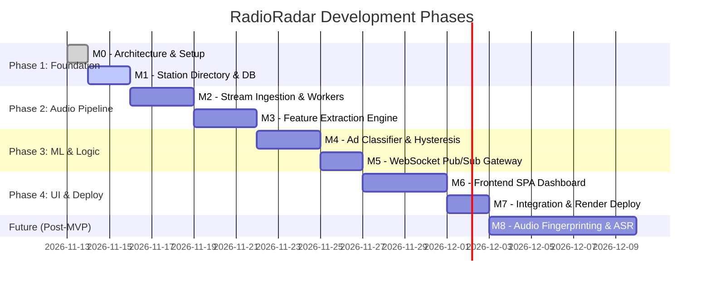

# RadioRadar: Development Roadmap

This document outlines the phased, milestone-based implementation strategy for RadioRadar. Each milestone represents an independently testable, functional layer of the system.

---

## Roadmap Overview & MVP Boundary

### MVP vs. Deferred Feature Matrix

| Feature | Target | Rationale |
|---|---|---|
| **Station Directory by Language** | **MVP** | Essential for user station discovery and selection. |
| **Manual Station Selection (up to 3)** | **MVP** | Core requirement; capped to 3 for free-tier resource safety. |
| **Shared Stream Ingestion** | **MVP** | Mandatory to prevent server OOM when multiple users monitor identical stations. |
| **Acoustic Feature Extraction (NumPy)** | **MVP** | Fast, low-memory feature generation (<10 MB RAM). |
| **Lightweight Scikit-learn Classifier** | **MVP** | Low-resource ML model capable of running within Render's 512MB RAM. |
| **5 Monitoring States + Hysteresis** | **MVP** | Ensures deterministic states (`Ad`, `No Ad`, `Analyzing`, `Uncertain`, `Unavailable`). |
| **WebSocket Real-time Broadcasting** | **MVP** | Delivers immediate status transitions to UI without polling. |
| **HTML5 Direct Stream Player** | **MVP** | Allows listening without routing audio bytes through backend. |
| *Speech-to-Text / Whisper ASR* | *Deferred* | Requires 1GB+ VRAM/RAM; completely incompatible with 512MB free tier. |
| *Audio Fingerprinting (ACR)* | *Deferred* | Requires maintaining a massive reference database of commercial jingles. |
| *User Authentication & Accounts* | *Deferred* | Unnecessary complexity for open-source public utility. |
| *Multi-Node Distributed Scaling* | *Deferred* | Out of scope for single-container free-tier deployment. |

---

## Detailed Milestone Specifications

### Milestone 0: Architecture, Setup & Planning (Current)
- **Objective**: Establish complete technical specifications, feasibility studies, risk mitigations, repository structure, and CI/CD foundations.
- **Features**:
  - Architectural blueprint (`ARCHITECTURE.md`).
  - Milestone roadmap with MVP bounds (`ROADMAP.md`).
  - Technical risk register (`RISKS.md`).
  - Git repository initialization and verified GitHub remote linkage.
- **Files / Modules Involved**:
  - `ARCHITECTURE.md`
  - `ROADMAP.md`
  - `RISKS.md`
  - `.gitignore`
  - `README.md`
- **Dependencies**: None.
- **Testing Requirements**: Git status verification; markdown syntax and documentation consistency checks.
- **Completion Criteria**: Complete, unambiguous documentation committed to repository and pushed to GitHub remote.
- **Risks**: Architectural over-optimism without empirical memory budgeting (mitigated by explicit free-tier RAM profiling).

---

### Milestone 1: Station Directory & Language Catalog Service
- **Objective**: Implement the station storage layer, pre-seeded catalog, and language-grouping query service.
- **Features**:
  - SQLite database setup with WAL mode and schema migrations.
  - Curated seed dataset covering top global languages: English, Hindi, Spanish, French, German, Arabic, etc.
  - Radio Browser API sync client with timeout and fallback logic.
  - REST endpoints for station search, language filtering, and health checks.
- **Files / Modules Involved**:
  - `backend/app/db/database.py` (SQLite connection engine)
  - `backend/app/db/models.py` (Station schema)
  - `backend/app/db/seed_data.py` (High-uptime station seed list)
  - `backend/app/services/catalog.py` (Search and language aggregation)
  - `backend/app/api/stations.py` (FastAPI router)
- **Dependencies**: `fastapi`, `uvicorn`, `sqlalchemy` or `aiosqlite`, `pydantic`, `httpx`.
- **Testing Requirements**:
  - Unit tests for database initialization and schema creation.
  - Unit tests for station filtering by language.
  - Integration test for Radio Browser API fallback behavior.
- **Completion Criteria**: Station catalog returns structured JSON with language groups and responds in $<25\text{ms}$ locally.
- **Risks**: External Radio Browser API downtime or rate-limiting (mitigated by local curated seed cache).

---

### Milestone 2: Audio Ingestion & Shared Stream Worker Pipeline
- **Objective**: Build the single-station ingestion worker, FFmpeg subprocess pipe, circular ring buffer, and multi-subscriber manager.
- **Features**:
  - Subprocess FFmpeg audio decoder configured for 16kHz mono `f32le` streaming.
  - Memory-capped circular PCM buffer (10-second rolling window).
  - `StreamManager` singleton enforcing a maximum cap of 3 concurrent active streams.
  - Automatic stream reconnection with exponential backoff on dropouts.
  - Subscriber reference counter with a 60-second shutdown grace timer.
- **Files / Modules Involved**:
  - `backend/app/audio/stream_worker.py` (FFmpeg subprocess & circular buffer)
  - `backend/app/audio/manager.py` (StreamManager singleton & pool lifecycle)
  - `backend/app/core/config.py` (Configurable buffer sizes, timeouts, limits)
- **Dependencies**: FFmpeg binary installed on host/container, `asyncio`.
- **Testing Requirements**:
  - Mock stream ingestion tests (using synthetic PCM pipes).
  - Test automatic reconnection on abrupt stream EOF.
  - Concurrency test: verifying that 10 subscribers to the same station spawn exactly 1 FFmpeg process.
  - Capacity test: verifying rejection or queuing when a 4th unique stream is requested.
  - Memory leak test over a 30-minute sustained stream.
- **Completion Criteria**: Worker continuously decodes live stream into memory with steady RAM consumption $<40\text{ MB}$ per stream.
- **Risks**: FFmpeg zombie subprocesses upon unhandled exceptions (mitigated with explicit process group cleanup handlers).

---

### Milestone 3: Lightweight Real-Time Feature Extraction Engine
- **Objective**: Implement pure NumPy/SciPy acoustic feature extraction operating on sliding audio windows.
- **Features**:
  - Sliding window segmenter (2.5-second frame, 0.75-second hop).
  - Short-Time Energy & RMS dynamic range computation.
  - Zero Crossing Rate (ZCR) and unvoiced/voiced ratio.
  - Spectral centroid, spectral rolloff, and spectral flatness.
  - NumPy-based Mel-Frequency filter bank (13 MFCC coefficients).
  - Micro-pause and boundary silence detector.
- **Files / Modules Involved**:
  - `backend/app/audio/features.py` (Pure NumPy feature extraction functions)
  - `backend/app/audio/constants.py` (Sample rates, FFT sizes, Mel filter coefficients)
- **Dependencies**: `numpy`, `scipy`. (Explicitly **no** `librosa`).
- **Testing Requirements**:
  - Numerical parity tests validating feature extraction against known reference signals (pure tone, white noise, speech sample).
  - Performance benchmark: Feature extraction on a 2.5s window must execute in $<15\text{ms}$ on a single CPU thread.
  - Memory profiling: Zero incremental heap growth per frame.
- **Completion Criteria**: Feature extractor processes 100 consecutive frames in $<1.5\text{s}$ total CPU time with constant memory.
- **Risks**: CPU exhaustion if window overlap is too dense (mitigated by 0.75s hop step).

---

### Milestone 4: Ad Classifier, Hysteresis Filter & State Machine
- **Objective**: Develop the classification engine and temporal smoothing logic to emit reliable monitoring states.
- **Features**:
  - Pre-trained baseline Random Forest classifier serialized via `joblib`.
  - Synthetic and curated evaluation dataset script for repeatable local verification.
  - Multi-tier classification logic (Metadata inspect -> Acoustic ML -> Hysteresis).
  - Moving-window probability buffer (last 6 frames) with asymmetric hysteresis thresholds.
  - Explicit 5-state lifecycle management (`Advertisement detected`, `No advertisement detected`, `Analyzing`, `Uncertain`, `Unavailable`).
- **Files / Modules Involved**:
  - `backend/app/ml/classifier.py` (Model loader and inference wrapper)
  - `backend/app/ml/hysteresis.py` (Temporal smoothing and state transitions)
  - `backend/app/ml/train_baseline.py` (Script to train lightweight model on benchmark samples)
  - `backend/app/ml/models/baseline_rf.joblib` (Trained model artifact)
- **Dependencies**: `scikit-learn`, `joblib`, `numpy`.
- **Testing Requirements**:
  - Unit tests for state transitions under alternating probability sequences (verifying no rapid state flickering).
  - Unit tests for timeout transitions to `Unavailable` when audio input ceases.
  - Confusion matrix evaluation on curated public radio audio slices.
- **Completion Criteria**: Hysteresis filter eliminates 100% of single-frame state fluctuations and outputs stable states.
- **Risks**: Acoustic confusion on talk-radio / news stations (mitigated by clearly surfacing `Uncertain` state).

---

### Milestone 5: WebSocket Pub/Sub Protocol & Real-Time Gateway
- **Objective**: Integrate backend stream workers with FastAPI WebSockets to broadcast live states to connected clients.
- **Features**:
  - WebSocket connection manager supporting multiplexed station subscriptions.
  - Periodic heartbeat ping/pong to detect dead client sockets.
  - Structured JSON message schema for subscription, status, and error states.
  - Graceful connection termination and subscriber count synchronization.
- **Files / Modules Involved**:
  - `backend/app/api/websocket.py` (FastAPI WebSocket route & client session tracking)
  - `backend/app/core/protocol.py` (Pydantic models for WebSocket payloads)
- **Dependencies**: `fastapi`, `uvicorn`, `pydantic`.
- **Testing Requirements**:
  - WebSocket unit test using FastAPI `TestClient.websocket_connect`.
  - Multi-client subscription broadcast test.
  - Disconnect cleanup test: verifying subscriber reference count drops to 0 when client disconnects.
- **Completion Criteria**: WebSocket server pushes state update payloads to multiple connected test clients within $<50\text{ms}$ of state transition.
- **Risks**: Stale WebSocket connections leaking worker allocations (mitigated by ping/pong heartbeats every 25 seconds).

---

### Milestone 6: React Frontend Application & Dashboard
- **Objective**: Build the user-facing web interface for language browsing, 3-station monitoring, and direct stream listening.
- **Features**:
  - Modern, responsive UI with Tailwind CSS and Dark/Light themes.
  - Station Browser: Language filter tabs/dropdowns, text search, station cards with metadata.
  - 3-Slot Monitoring Dock:
    * Displays up to 3 selected stations.
    * Visual state indicators with distinct color coding and badges:
      - 🔴 **Advertisement detected**
      - 🟢 **No advertisement detected**
      - 🟡 **Analyzing**
      - 🟠 **Uncertain**
      - ⚪ **Unavailable**
    * Live confidence meter and audio dynamics display (RMS loudness).
  - Direct HTML5 Audio Player widget connecting directly to the station stream URL.
  - Resilient WebSocket client with automatic reconnection and exponential backoff.
- **Files / Modules Involved**:
  - `frontend/src/App.tsx` (Main layout)
  - `frontend/src/components/StationExplorer.tsx` (Catalog and language filter)
  - `frontend/src/components/MonitorGrid.tsx` (3-slot monitoring view)
  - `frontend/src/components/StationCard.tsx` (Individual station status card)
  - `frontend/src/components/AudioPlayer.tsx` (Direct HTML5 audio listener)
  - `frontend/src/hooks/useWebSocket.ts` (Resilient WebSocket manager)
  - `frontend/src/types/index.ts` (Shared TypeScript interfaces)
- **Dependencies**: `react`, `react-dom`, `vite`, `tailwindcss`, `lucide-react`.
- **Testing Requirements**:
  - Vitest component unit tests for `StationCard` state transitions.
  - Mock WebSocket integration tests.
  - Cross-browser HTML5 `<audio>` playback validation.
- **Completion Criteria**: Interactive UI enables station selection, shows responsive state transitions, and supports direct audio listening.
- **Risks**: Browser mixed-content warnings if stream URLs are HTTP rather than HTTPS (mitigated by surfacing audio playback warnings or filtering HTTPS streams).

---

### Milestone 7: Integration, Performance Profiling & Render Deployment
- **Objective**: Package the entire system in a multi-stage Docker container, profile memory consumption, and deploy to Render free tier.
- **Features**:
  - Multi-stage `Dockerfile`:
    * Stage 1: Build React frontend with Vite.
    * Stage 2: Python 3.11-slim base, install FFmpeg, copy built frontend assets, install locked Python dependencies.
  - Unified static file serving (FastAPI serves built React frontend + API + WebSockets on a single port).
  - 24-hour continuous stream stability test under simulated 3-station load.
  - Memory profiling under maximum load to verify $<500\text{ MB}$ footprint.
  - `render.yaml` infrastructure-as-code deployment specification.
- **Files / Modules Involved**:
  - `Dockerfile`
  - `.dockerignore`
  - `render.yaml`
  - `backend/app/main.py` (Mounts SPA static directory and API routers)
- **Dependencies**: Docker, Render Free Tier.
- **Testing Requirements**:
  - Docker container build and run verification.
  - Memory profiling using `psutil` / `tracemalloc` under 3 concurrent streams.
  - Cold-start time measurement ($<10\text{s}$ container startup).
- **Completion Criteria**: Application is live, accessible via web browser, successfully monitors 3 live stations, and maintains steady RAM $<480\text{ MB}$.
- **Risks**: Render free tier 512MB OOM crash (mitigated by strict single-worker Uvicorn, FFmpeg mono downsampling, and absence of heavy ML libraries).
