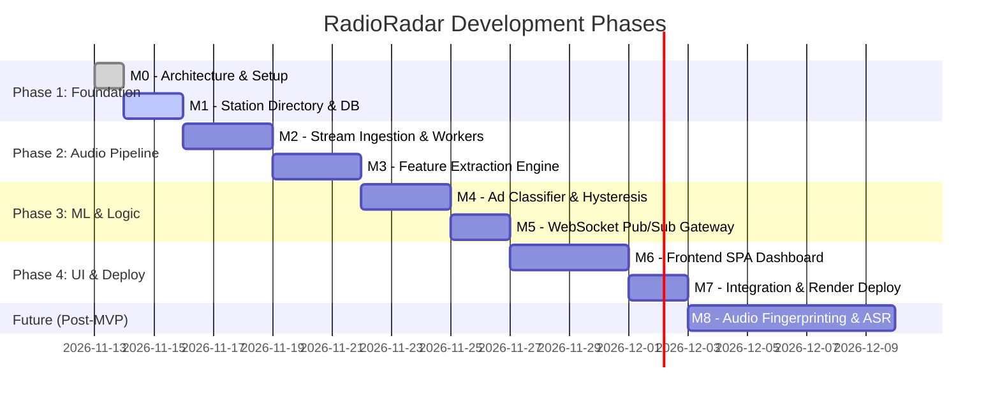

# RadioRadar: Development Roadmap

This document outlines the phased, milestone-based implementation strategy for RadioRadar. Each milestone represents an independently testable, functional layer of the system with empirical measurement criteria.

---

## Roadmap Overview & MVP Boundary

### MVP vs. Deferred Feature Matrix

| Feature | Target | Rationale & Resource Implications |
|---|---|---|
| **Station Directory by Language** | **MVP** | Essential for user station discovery; backed by rebuildable SQLite cache. |
| **Manual Station Selection (up to 3)** | **MVP** | Core capability; maximum 3 streams subject to empirical CPU/RAM benchmarking. |
| **Shared Stream Ingestion** | **MVP** | Mandatory to prevent server OOM when multiple users monitor identical stations. |
| **Acoustic Feature Extraction (NumPy)** | **MVP** | Fast, low-memory feature generation replacing Librosa to conserve RAM. |
| **Baseline Scikit-learn Classifier** | **MVP** | Initial lightweight baseline compared against dummy and linear models. |
| **5 Monitoring States + Hysteresis** | **MVP** | Stabilizes output states (`Ad`, `No Ad`, `Analyzing`, `Uncertain`, `Unavailable`). |
| **WebSocket Real-time Broadcasting** | **MVP** | Pushes state updates; requires client ping messages to signal activity on Render. |
| **HTML5 Direct Stream Player** | **MVP** | Client connects directly to origin stream; reduces redistribution liability. |
| *Speech-to-Text / Whisper ASR* | *Deferred* | Incompatible with 512MB RAM and 0.1 vCPU (10% CFS quota) free-tier envelope [HYPOTHESIS]. |
| *Audio Fingerprinting (ACR)* | *Deferred* | Requires maintaining an external reference database of commercial jingles. |
| *User Authentication & Accounts* | *Deferred* | Unnecessary complexity for open-source public utility MVP. |
| *Multi-Node Distributed Scaling* | *Deferred* | Out of scope for single-container free-tier deployment. |

---

## Detailed Milestone Specifications

### Milestone 0: Architecture, Setup & Planning (Completed)
- **Objective**: Establish complete technical specifications, feasibility studies, risk mitigations, repository structure, and CI/CD foundations.
- **Features**:
  - Architectural blueprint (`ARCHITECTURE.md`).
  - Milestone roadmap with MVP bounds (`ROADMAP.md`).
  - Technical risk register (`RISKS.md`).
  - Dataset research and data strategy (`DATASET_RESEARCH.md`).
  - Machine learning experiment plan and approach comparison (`ML_EXPERIMENT_PLAN.md`).
  - Git repository initialization and verified GitHub remote linkage.
- **Files / Modules Involved**:
  - `ARCHITECTURE.md`
  - `ROADMAP.md`
  - `RISKS.md`
  - `DATASET_RESEARCH.md`
  - `ML_EXPERIMENT_PLAN.md`
  - `.gitignore`
  - `README.md`
  - `LICENSE`
- **Dependencies**: None.
- **Testing Requirements**: Git status verification; markdown syntax and documentation consistency checks.
- **Completion Criteria**: Complete, unambiguous documentation committed to repository and pushed to GitHub remote.
- **Risks**: Architectural over-optimism without empirical memory budgeting (mitigated by explicit unverified labels, dataset research, and risk register).

---

### Milestone 1: Station Directory & Language Catalog Service
- **Objective**: Implement the rebuildable station storage layer, pre-seeded catalog, fallback logic for external APIs, and language-grouping query service.
- **Features**:
  - Rebuildable SQLite cache initialization with WAL mode (`PRAGMA journal_mode=WAL;`).
  - Pre-seeded high-uptime station catalog covering functional languages (**English**, **Hindi**) and conceptual placeholder languages (**Tamil**, **Kannada**, **Punjabi**).
  - Radio Browser API synchronization client with 5.0s timeouts, retry limit (max 2 retries), circuit breaker, and static seed fallback.
  - Stream URL SSRF validation filter (blocking loopback, link-local, and private subnets).
  - REST endpoints for station search, language filtering, and health checks.
- **Files / Modules Involved**:
  - `backend/app/db/database.py` (SQLite connection & rebuild logic)
  - `backend/app/db/models.py` (Station schema)
  - `backend/app/db/seed_data.py` (Bundled static seed dataset)
  - `backend/app/services/catalog.py` (Search, language aggregation & API sync)
  - `backend/app/api/stations.py` (FastAPI router)
- **Dependencies**: `fastapi`, `uvicorn`, `aiosqlite`, `pydantic`, `httpx`.
- **Testing Requirements**:
  - Unit tests verifying database creation and seed population from cold start.
  - Unit tests for station filtering by language and search query.
  - Integration test simulating Radio Browser API timeout / network failure, verifying fallback to static seed.
  - Security unit test verifying rejection of SSRF stream URLs (`127.0.0.1`, `169.254.169.254`, `file://`).
- **Completion Criteria**:
  - Rebuildable database initializes and seeds from scratch in $<500\text{ms}$ on cold boot.
  - Catalog query endpoints respond in $<30\text{ms}$ for cached records.
  - 100% test pass rate across unit and fallback integration suites.
- **Risks**: Radio Browser API mirror downtime (mitigated by bundled seed fallback and circuit breaker).

---

### Milestone 2: Audio Ingestion & Shared Stream Worker Pipeline
- **Objective**: Build the single-station ingestion worker, FFmpeg subprocess pipe, circular ring buffer, and multi-subscriber manager, empirically benchmarking resource consumption.
- **Features**:
  - Subprocess FFmpeg audio decoder configured for 16kHz mono `f32le` streaming with auto-reconnect parameters.
  - Memory-capped circular PCM buffer (10-second rolling window per active station).
  - `StreamManager` singleton enforcing concurrency control (initial operational target: 1 active stream on Render Free Tier; empirical stress-testing benchmark up to 3 streams).
  - Automatic stream reconnection with exponential backoff on dropouts; watchdog timer for hung streams.
  - Subscriber reference counter with a 60-second shutdown grace timer.
- **Files / Modules Involved**:
  - `backend/app/audio/stream_worker.py` (FFmpeg subprocess & circular buffer)
  - `backend/app/audio/manager.py` (StreamManager singleton & pool lifecycle)
  - `backend/app/core/config.py` (Configurable buffer sizes, timeouts, limits)
- **Dependencies**: FFmpeg binary installed on host/container, `asyncio`, `psutil`.
- **Testing Requirements**:
  - Mock stream ingestion tests (using local synthetic PCM audio pipes).
  - Reconnection test: simulate sudden network drops and verify backoff reconnection and transition to `Unavailable` after 3 consecutive failures.
  - Multiplexing test: verify that 10 concurrent subscribers to the same station spawn exactly 1 FFmpeg process.
  - **Empirical Resource Profiling**: Measure actual RSS memory and CPU utilization with `psutil` under 1, 2, and 3 active streams.
- **Completion Criteria**:
  - Worker maintains continuous ingestion of live test streams without memory accumulation over a 15-minute test.
  - Measured resource report produced: exact RAM and CPU overhead per active stream documented in test artifacts.
  - Graceful cleanup verified: zero orphan or zombie FFmpeg subprocesses left upon worker shutdown.
- **Risks**: Subprocess pipe lag or CPU starvation on constrained 0.1 vCPU (to be evaluated during empirical benchmarking).

---

### Milestone 3: Lightweight Real-Time Feature Extraction Engine
- **Objective**: Implement pure NumPy/SciPy acoustic feature extraction operating on sliding audio windows, benchmarking throughput on constrained CPU.
- **Features**:
  - Sliding window segmenter: 2.5-second audio analysis window ($40,000\text{ samples}$ at 16 kHz) with a 0.75-second prediction interval ($1.75\text{s}$ overlap).
  - Unpadded STFT configuration (`center=False`, $N_{\text{fft}}=512$, $N_{\text{hop}}=256$, Hann window) yielding exactly 155 sub-frames per 2.5s window.
  - Short-Time Energy & Log RMS calculation with numerical stabilization $\epsilon_{\text{rms}}=10^{-12}$.
  - Zero Crossing Rate (ZCR) globally over 40,000 samples.
  - Spectral centroid, rolloff 85%, and spectral flatness (power spectrum with $\epsilon=10^{-12}$) summarized as means across 155 sub-frames.
  - NumPy-based 26 Mel filter bank yielding 13 static MFCCs ($c_0$ to $c_{12}$) and 13 delta MFCCs.
  - Micro-pause detector (50 non-overlapping 50ms sub-blocks, thresholded at $-30.0\text{ dBFS}$).
  - Engineering spike decisions: HTK vs Slaney filter weights, delta regression boundary handling.
- **Files / Modules Involved**:
  - `backend/app/audio/features.py` (Pure NumPy feature extraction functions)
  - `backend/app/audio/constants.py` (Sample rates, FFT sizes, Mel filter coefficients)
- **Dependencies**: `numpy`, `scipy`. (Explicitly **no** `librosa`).
- **Testing Requirements**:
  - Numerical sanity tests validating feature extraction outputs against known synthetic signals (silence, white noise, pure sine wave).
  - **Empirical Execution Benchmark**: Profile CPU execution time per 2.5-second frame under simulated CPU throttling.
  - **Memory Leak Profiling**: Run 500 consecutive frame extractions with `tracemalloc` to verify zero memory leaks.
- **Completion Criteria**:
  - Measured single-frame feature extraction completes in $<20\text{ms}$ on a single thread.
  - Memory allocation remains constant across continuous iterations (zero net heap growth).
- **Risks**: Computational bottleneck if FFT or filter bank calculations stall under 0.1 CPU allocation.

---

### Milestone 4: Ad Classifier, Hysteresis Filter & State Machine
- **Objective**: Establish the machine learning evaluation pipeline, train an initial baseline model against defined comparisons, and implement temporal hysteresis.
- **Features**:
  - Binary classifier scope (`ADVERTISEMENT` vs. `NON_ADVERTISEMENT`) across functional target languages (**English**, **Hindi**), treating **Tamil**, **Kannada**, and **Punjabi** strictly as conceptual UI placeholders.
  - Granular ground-truth labels (`MUSIC`, `TALK`, `NEWS`, `OTHER`) preserved for slice diagnostics; `UNCERTAIN` ground-truth samples quarantined.
  - 5-fold GroupKFold cross-validation grouped strictly by station ID (outer test on 1 station, training on 4; inner validation limited by 4 station groups; small predeclared baseline comparisons; reporting per-station results and class distributions; no fabricated confidence intervals; 20–50+ stations as informal planning target).
  - Baseline model comparisons: Majority-class baseline, Logistic Regression, shallow Random Forest (`max_depth=6..8`, `n_estimators=30..50`), and HistGradientBoosting.
  - Moving-window probability buffer (last 6 frames covering 6.25s audio span across 3.75s step time) with asymmetric hysteresis thresholds.
  - Explicit 5-state lifecycle management (`Advertisement detected`, `No advertisement detected`, `Analyzing`, `Uncertain`, `Unavailable`) with abstention reporting.
  - Distinction between steady-state internal detector response (~2.37s) and total studio-to-UI broadcast lag (~7.8-11.6+ s [UNMEASURED HYPOTHESIS]).
- **Files / Modules Involved**:
  - `backend/app/ml/classifier.py` (Model loader and inference wrapper)
  - `backend/app/ml/hysteresis.py` (Temporal smoothing and state transitions)
  - `backend/app/ml/train_baseline.py` (Model training script with cross-validation)
  - `backend/app/ml/evaluate.py` (Evaluation reporting: precision, recall, F1, confusion matrix)
- **Dependencies**: `scikit-learn`, `joblib`, `numpy`.
- **Testing Requirements**:
  - Unit tests for state machine transitions under controlled probability sequences (verifying prevention of rapid state flapping).
  - Unit tests for timeout transitions to `Unavailable` when audio frames stop arriving.
  - **Empirical Classification Evaluation**: Compute precision, recall, macro F1-score, and confusion matrix on the held-out test split.
  - **False-Positive Analysis**: Specifically evaluate false positive rates on continuous speech samples (talk radio / news).
- **Completion Criteria**:
  - Empirical evaluation report generated with precision, recall, and F1 across each class, with no fabricated figures.
  - Hysteresis filter eliminates single-frame oscillations under fluctuating input probabilities.
- **Risks**: High false-positive rates on talk radio / podcasts (mitigated by surfacing the `Uncertain` state).

---

### Milestone 5: WebSocket Pub/Sub Protocol & Real-Time Gateway
- **Objective**: Integrate backend stream workers with FastAPI WebSockets to broadcast live states, supporting client activity heartbeats.
- **Features**:
  - WebSocket connection manager supporting multiplexed station subscriptions.
  - Inbound client heartbeat ping handler to register activity on Render free tier.
  - Structured JSON message schema for subscription, status, and error states.
  - Graceful connection termination and subscriber count synchronization.
- **Files / Modules Involved**:
  - `backend/app/api/websocket.py` (FastAPI WebSocket route & client session tracking)
  - `backend/app/core/protocol.py` (Pydantic models for WebSocket payloads)
- **Dependencies**: `fastapi`, `uvicorn`, `pydantic`.
- **Testing Requirements**:
  - WebSocket unit tests using FastAPI `TestClient.websocket_connect`.
  - Multi-client subscription broadcast test verifying state dissemination.
  - Client disconnect cleanup test verifying subscriber count decrements and grace timer initiates.
- **Completion Criteria**:
  - WebSocket server pushes state update payloads to connected test clients within $<50\text{ms}$ of state transition.
  - Worker lifecycle triggers correctly when subscriber count reaches 0.
- **Risks**: Stale or silent WebSocket connections causing unexpected container spin-down (mitigated by client ping cadence).

---

### Milestone 6: React Frontend Application & Dashboard
- **Objective**: Build the user-facing web interface for language browsing, 3-station monitoring, and direct stream listening with cold-start UX indicators.
- **Features**:
  - Responsive UI with Tailwind CSS and Dark/Light themes.
  - Station Browser: Language filter tabs/dropdowns, text search, station cards with metadata from rebuildable cache.
  - 3-Slot Monitoring Dock:
    * Displays up to 3 selected stations.
    * Visual state indicators:
      - 🔴 **Advertisement detected**
      - 🟢 **No advertisement detected**
      - 🟡 **Analyzing**
      - 🟠 **Uncertain**
      - ⚪ **Unavailable**
    * Live confidence score and audio dynamics display (RMS loudness).
  - Direct HTML5 Audio Player widget connecting directly to the station stream URL.
  - Inactivity & Cold-Start UX: Visual banner notifying users when the server is waking from sleep.
  - WebSocket client with automatic reconnection, exponential backoff, and periodic ping activity messages.
- **Files / Modules Involved**:
  - `frontend/src/App.tsx` (Main layout)
  - `frontend/src/components/StationExplorer.tsx` (Catalog and language filter)
  - `frontend/src/components/MonitorGrid.tsx` (3-slot monitoring view)
  - `frontend/src/components/StationCard.tsx` (Individual station status card)
  - `frontend/src/components/AudioPlayer.tsx` (Direct HTML5 audio listener)
  - `frontend/src/hooks/useWebSocket.ts` (Resilient WebSocket manager with ping keep-alive)
  - `frontend/src/types/index.ts` (Shared TypeScript interfaces)
- **Dependencies**: `react`, `react-dom`, `vite`, `tailwindcss`, `lucide-react`.
- **Testing Requirements**:
  - Vitest component unit tests for `StationCard` state transitions.
  - Mock WebSocket integration tests covering reconnect loops.
  - Mixed-content warning verification: verify UI flags HTTP audio streams when running on HTTPS.
- **Completion Criteria**:
  - User can search and filter stations by language and select up to 3 for concurrent monitoring.
  - Dashboard correctly renders all 5 monitoring states from mock or live feeds.
- **Risks**: Mixed-content browser blocks when streaming unencrypted HTTP radio URLs from an HTTPS frontend.

---

### Milestone 7: Integration, Performance Profiling & Render Deployment
- **Objective**: Package the application in Docker, empirically profile CPU and memory consumption under load, and deploy to Render free tier.
- **Features**:
  - Multi-stage `Dockerfile`:
    * Stage 1: Build React frontend with Vite.
    * Stage 2: Python 3.11-slim base, install FFmpeg, copy built frontend assets, install locked Python dependencies.
  - Unified static file serving (FastAPI serves built React frontend + API + WebSockets on a single port).
  - Empirical memory and CPU profiling under 1, 2, and 3 simultaneous streams.
  - Verification of 15-minute inactivity spin-down and ~50-60s cold-start recovery.
  - `render.yaml` infrastructure-as-code deployment specification.
- **Files / Modules Involved**:
  - `Dockerfile`
  - `.dockerignore`
  - `render.yaml`
  - `backend/app/main.py` (Mounts SPA static directory and API routers)
- **Dependencies**: Docker, Render Free Tier.
- **Testing Requirements**:
  - Docker container build and run verification.
  - **Empirical Memory & CPU Stress Benchmark**: Measure actual RSS memory usage and CPU load over a 2-hour continuous test with 3 active streams.
  - Cold-start timing measurement: measure container boot-up and cache rebuild latency.
- **Completion Criteria**:
  - Application deploys cleanly on Render free tier.
  - Measured RSS memory remains strictly below 500 MB under maximum active test load.
  - Stream workers terminate cleanly upon inactivity sleep, and rebuildable cache restores reliably upon wake-up.
- **Risks**: OOM crash or CPU pipe lag under sustained 3-stream load (if benchmark fails, concurrency cap will be adjusted to 2 or 1 stream).
